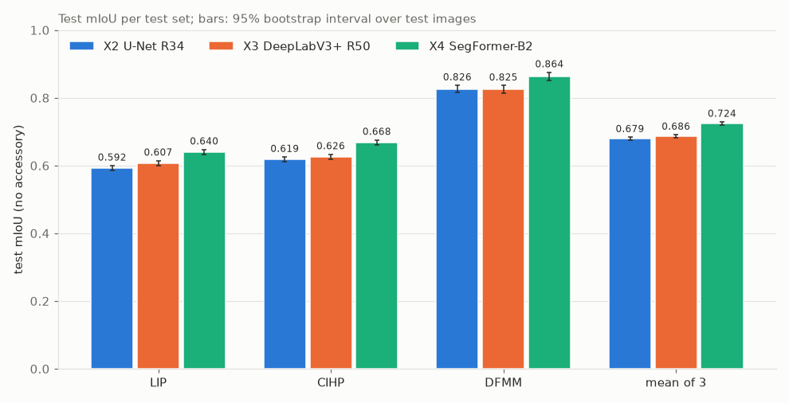
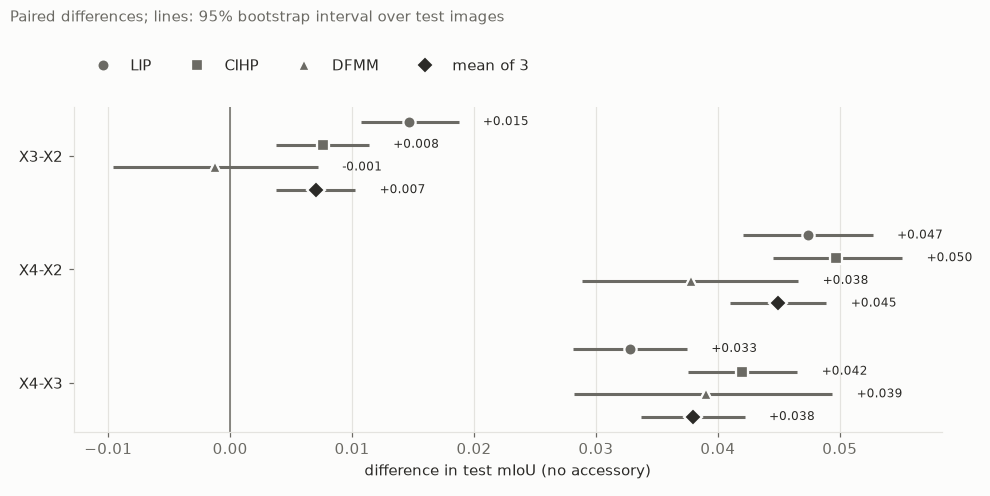
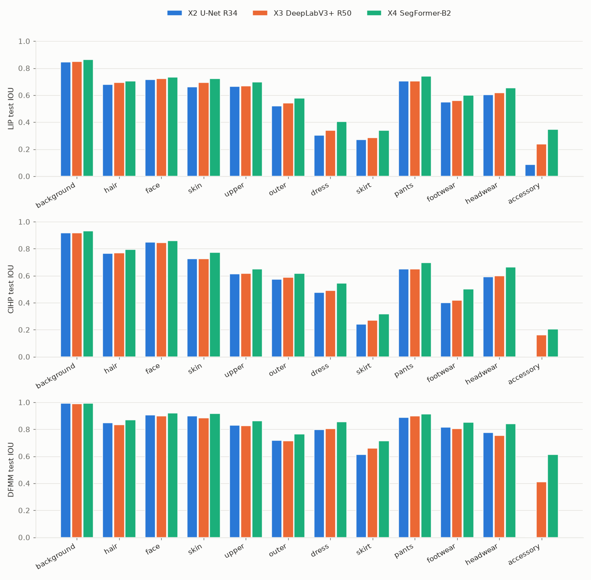
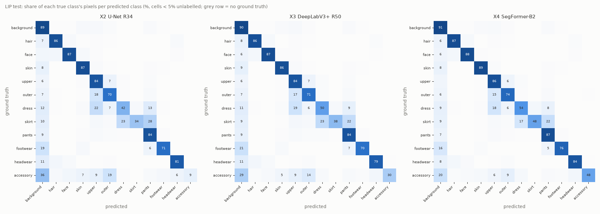
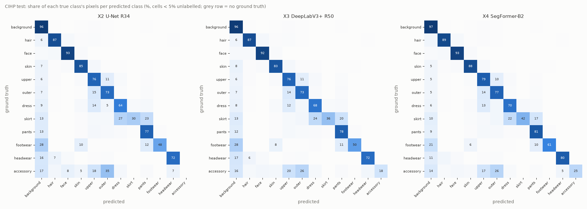
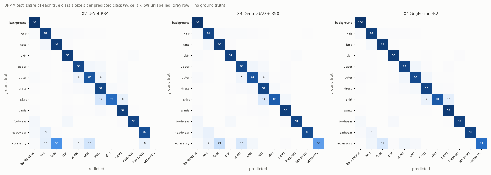

# T9 — ผลประเมินสามโมเดลบน test set

## In plain words
SegFormer-B2 (X4) ดีที่สุดบนทั้งสาม test set และดีกว่าในทุกคลาส (12 คลาส × 3 test set = 36 คู่) mIoU ไม่นับ `accessory` เฉลี่ยสามชุดได้ 0.724 เทียบกับ DeepLabV3+ (X3) 0.686 และ U-Net (X2) 0.679
ความต่างระหว่าง X4 กับอีกสองโมเดลใหญ่กว่าความไม่แน่นอนจากการสุ่ม test image มาก ส่วน X3 กับ X2 บน DFMM ถือว่าเท่ากัน
คะแนนเพิ่มตาม M10 (d1, d2) ขยับ mIoU ไม่ถึง 0.005 และไม่เปลี่ยนลำดับโมเดล ขั้นต่อไปคือ T10 (error analysis และข้อจำกัด)

## ข้อมูลที่ใช้

- **run:** X2 `20261105-1307-1acb88f-unet-r34`, X3 `20261105-2050-f4e2ffe-deeplabv3p-r50`, X4 `20261105-2220-ac9a26b-segformer-b2` ทุก run ใช้ `data_version` `splits-v2-d023252b81d9` และ `eval-v2` (eval protocol ที่ frozen) checkpoint คือ `best.pt` ที่ step 40000 ทั้งสาม run
- **คะแนนทางการ:** `runs/<run>/eval/eval-v2/<dataset>/metrics.json` ไม่มีการวัดผลใหม่ และไม่ได้แก้ `evaluate.py`
- **คะแนนเพิ่มและช่วงความเชื่อมั่น:** ใช้ไฟล์ที่ M10 เขียนไว้ใน `data/review/M10/breakdown/<run>/<dataset>/` (`raw_confusion.json` และ `per_image_shared.csv`) ไม่ต้องใช้ GPU
- **รูปตัวอย่าง:** ใช้ GPU ทาย 24 รูป (8 รูปต่อ test set) ราว 9 วินาที ด้วย `scripts/review_predictions.py configs/review/t9.yaml` mask ที่ทายถูกเก็บไว้ที่ `data/review/T9/` สคริปต์เช็กทุก mask ที่บันทึกกับจำนวนพิกเซลของ M10 แล้ว ตรงกันทั้งหมด

สร้างทุกอย่างใหม่ได้ด้วยคำสั่ง:

```bash
uv run python scripts/t9_results.py configs/report/t9.yaml       # ตาราง, JSON, กราฟ (ไม่ใช้ GPU)
uv run python scripts/review_predictions.py configs/review/t9.yaml  # เลือกรูปและทาย mask (GPU, ถือ GPU lock)
uv run python scripts/t9_qualitative.py configs/review/t9.yaml   # วาดรูปเปรียบเทียบลง data/review/T9/figures/ (ไม่ใช้ GPU)
```

ตัวเลขทุกตัวในรายงานนี้มาจาก `docs/reports/2026-11-07-T9-results.json` ส่วน `docs/reports/2026-11-07-T9-tables.md` มีตารางครบทุกตาราง รวมถึง Dice ต่อคลาส ทั้งสองไฟล์สคริปต์สร้างขึ้น ห้ามแก้ด้วยมือ

## วิธีวัด

- **mIoU หลัก (headline):** ค่าเฉลี่ย IoU ของ 11 คลาส ไม่นับ `accessory` ตามที่ตัดสินไว้ใน M6 ตารางแสดง mIoU 12 คลาสคู่กันไว้ด้วย IoU (intersection over union) = พิกเซลที่ทายถูก / (ถูก + ทายเกิน + ทายขาด) ของแต่ละคลาส คิดจาก confusion matrix ของทั้ง test set (ไม่ใช่ค่าเฉลี่ยของแต่ละรูป)
- **Dice:** = 2 × ถูก / (2 × ถูก + ทายเกิน + ทายขาด) ต่อคลาส Dice เป็นฟังก์ชันเพิ่มของ IoU (Dice = 2·IoU / (1 + IoU)) ลำดับโมเดลในแต่ละคลาสจึงเหมือนกับ IoU เสมอ รายงานนี้จึงพูดถึง IoU เป็นหลัก
- **ค่าเฉลี่ยสามชุด:** เฉลี่ย mIoU ของ LIP, CIHP และ DFMM ให้น้ำหนักเท่ากัน ไม่รวมพิกเซลทุกชุดเข้าด้วยกัน เพราะรูป DFMM ใหญ่กว่ารูป LIP ราว 11 เท่า (M3)
- **ช่วงความเชื่อมั่น 95% (bootstrap):** สุ่มรูปจาก test set แบบใส่คืน ให้ได้จำนวนเท่าเดิม 2000 ครั้ง (seed 0) แล้วคิด mIoU ใหม่จากผลรวมพิกเซลของรูปที่สุ่มได้ ทุกโมเดลใช้รูปชุดเดียวกันในแต่ละครั้ง (paired) ความต่างระหว่างโมเดลจึงเทียบกันบนรูปเดียวกัน ช่วงนี้บอกแค่ว่าคะแนนจะแกว่งแค่ไหน **ถ้า test image เปลี่ยนไป** ไม่ได้รวมความแกว่งจากการเทรน (seed) เพราะเทรนโมเดลละ 1 run
- **คะแนนเพิ่ม d1, d2 (M10):** สร้าง confusion matrix ใหม่จากจำนวนพิกเซลราย raw class (คลาสเดิมของ dataset ก่อนรวม) แล้วตัด raw class ที่กำหนดออก เหมือนพิกเซลพวกนั้นเป็น IGNORE (ไม่นับคะแนน) ทั้งคะแนนก่อนและหลังตัดคิดจาก matrix ที่สร้างใหม่ ความต่างจึงมาจากพิกเซลที่ตัดออกเท่านั้น

**ตรวจซ้ำ:** matrix ที่สร้างจาก `raw_confusion.json` ตรงกับ `metrics.json` ทุกตัวสำหรับ X2 และ X3 ส่วน X4 ต่างกันไม่เกิน 0.00044 IoU เพราะ M10 วัด X4 ใหม่บน GPU อีกรุ่น (RTX 4070 แทน RTX 3060) ผลรวมของจำนวนพิกเซลรายรูปให้ mIoU เท่ากับ matrix ที่สร้างใหม่ทุก run (ตาราง "Cross-check" ในไฟล์ตาราง)

## ผล

### mIoU หลัก (ไม่นับ `accessory`)



| test set | รูป | X2 U-Net R34 | X3 DeepLabV3+ R50 | X4 SegFormer-B2 |
|---|---|---|---|---|
| LIP | 9632 | 0.5924 (0.585–0.600) | 0.6071 (0.600–0.615) | **0.6399** (0.632–0.647) |
| CIHP | 5000 | 0.6185 (0.611–0.625) | 0.6262 (0.619–0.633) | **0.6682** (0.660–0.676) |
| DFMM | 1293 | 0.8257 (0.815–0.837) | 0.8245 (0.813–0.836) | **0.8635** (0.852–0.875) |
| เฉลี่ยสามชุด | - | 0.6789 (0.674–0.684) | 0.6859 (0.681–0.691) | **0.7239** (0.719–0.729) |

ในวงเล็บคือช่วง bootstrap 95%

### ทุก metric

| test set | run | mIoU (12) | mIoU (ไม่นับ accessory) | mDice (12) | mDice (ไม่นับ accessory) | pixel acc |
|---|---|---|---|---|---|---|
| LIP | X2 | 0.5501 | 0.5924 | 0.6812 | 0.7289 | 0.8528 |
| LIP | X3 | 0.5764 | 0.6071 | 0.7122 | 0.7419 | 0.8590 |
| LIP | X4 | 0.6155 | 0.6399 | 0.7486 | 0.7698 | 0.8730 |
| CIHP | X2 | 0.5672 | 0.6185 | 0.6846 | 0.7464 | 0.8901 |
| CIHP | X3 | 0.5875 | 0.6262 | 0.7144 | 0.7541 | 0.8920 |
| CIHP | X4 | 0.6295 | 0.6682 | 0.7509 | 0.7883 | 0.9060 |
| DFMM | X2 | 0.7570 | 0.8257 | 0.8264 | 0.9014 | 0.9764 |
| DFMM | X3 | 0.7901 | 0.8245 | 0.8747 | 0.9012 | 0.9754 |
| DFMM | X4 | 0.8425 | 0.8635 | 0.9113 | 0.9251 | 0.9815 |
| เฉลี่ย | X2 | 0.6248 | 0.6789 | 0.7307 | 0.7922 | 0.9064 |
| เฉลี่ย | X3 | 0.6513 | 0.6859 | 0.7671 | 0.7990 | 0.9088 |
| เฉลี่ย | X4 | 0.6959 | 0.7239 | 0.8036 | 0.8277 | 0.9202 |

### ความต่างแบบ paired



| คู่ | LIP | CIHP | DFMM | เฉลี่ย |
|---|---|---|---|---|
| X3 − X2 | +0.0146 (+0.011 ถึง +0.019) | +0.0077 (+0.004 ถึง +0.011) | −0.0012 (−0.010 ถึง +0.007) | +0.0070 (+0.004 ถึง +0.010) |
| X4 − X2 | +0.0474 (+0.042 ถึง +0.053) | +0.0497 (+0.045 ถึง +0.055) | +0.0378 (+0.029 ถึง +0.047) | +0.0450 (+0.041 ถึง +0.049) |
| X4 − X3 | +0.0328 (+0.028 ถึง +0.037) | +0.0420 (+0.038 ถึง +0.047) | +0.0390 (+0.028 ถึง +0.049) | +0.0379 (+0.034 ถึง +0.042) |

### IoU ต่อคลาส



ตัวหนา = ดีที่สุดในแต่ละ test set (Dice ต่อคลาสอยู่ในไฟล์ตารางและ `figures/T9/dice_per_class.png`)

| คลาส | LIP X2 | LIP X3 | LIP X4 | CIHP X2 | CIHP X3 | CIHP X4 | DFMM X2 | DFMM X3 | DFMM X4 |
|---|---|---|---|---|---|---|---|---|---|
| background | 0.8448 | 0.8506 | **0.8629** | 0.9175 | 0.9181 | **0.9314** | 0.9923 | 0.9906 | **0.9935** |
| hair | 0.6807 | 0.6923 | **0.7048** | 0.7656 | 0.7682 | **0.7934** | 0.8476 | 0.8352 | **0.8679** |
| face | 0.7157 | 0.7225 | **0.7327** | 0.8476 | 0.8463 | **0.8608** | 0.9060 | 0.8979 | **0.9193** |
| skin | 0.6624 | 0.6940 | **0.7234** | 0.7267 | 0.7254 | **0.7732** | 0.8981 | 0.8856 | **0.9164** |
| upper | 0.6632 | 0.6695 | **0.6985** | 0.6127 | 0.6181 | **0.6489** | 0.8290 | 0.8258 | **0.8615** |
| outer | 0.5217 | 0.5417 | **0.5760** | 0.5742 | 0.5873 | **0.6187** | 0.7194 | 0.7145 | **0.7634** |
| dress | 0.3040 | 0.3405 | **0.4038** | 0.4750 | 0.4890 | **0.5452** | 0.7988 | 0.8036 | **0.8550** |
| skirt | 0.2701 | 0.2863 | **0.3405** | 0.2427 | 0.2691 | **0.3153** | 0.6140 | 0.6612 | **0.7142** |
| pants | 0.7025 | 0.7043 | **0.7409** | 0.6486 | 0.6512 | **0.6978** | 0.8867 | 0.8978 | **0.9143** |
| footwear | 0.5499 | 0.5586 | **0.6007** | 0.4014 | 0.4170 | **0.5023** | 0.8144 | 0.8034 | **0.8531** |
| headwear | 0.6016 | 0.6175 | **0.6543** | 0.5918 | 0.5982 | **0.6629** | 0.7768 | 0.7540 | **0.8400** |
| accessory | 0.0850 | 0.2394 | **0.3476** | 0.0022 | 0.1619 | **0.2041** | 0.0007 | 0.4120 | **0.6118** |

### คะแนนเพิ่ม d1, d2 (M10)

ตัดพิกเซลของ raw class ออกเฉพาะฝั่ง test เหมือนเป็น IGNORE คะแนนทางการยังเป็นตัวเลขหลัก

| | test set | คลาส | ตัดออก | พิกเซลที่ตัด (สัดส่วนของคลาส) | run | IoU ก่อน | IoU หลัง | Δ | mIoU ไม่นับ accessory ก่อน | หลัง | Δ |
|---|---|---|---|---|---|---|---|---|---|---|---|
| d1 | LIP | dress | jumpsuits | 3,312,565 (31.1%) | X2 | 0.3040 | 0.3217 | +0.0176 | 0.5924 | 0.5959 | +0.0035 |
| d1 | LIP | dress | jumpsuits | 3,312,565 (31.1%) | X3 | 0.3405 | 0.3265 | −0.0140 | 0.6071 | 0.6073 | +0.0002 |
| d1 | LIP | dress | jumpsuits | 3,312,565 (31.1%) | X4 | 0.4038 | 0.3992 | −0.0046 | 0.6399 | 0.6411 | +0.0012 |
| d2 | CIHP | footwear | socks | 1,286,257 (24.5%) | X2 | 0.4014 | 0.4401 | +0.0387 | 0.6185 | 0.6231 | +0.0046 |
| d2 | CIHP | footwear | socks | 1,286,257 (24.5%) | X3 | 0.4170 | 0.4427 | +0.0256 | 0.6262 | 0.6295 | +0.0033 |
| d2 | CIHP | footwear | socks | 1,286,257 (24.5%) | X4 | 0.5023 | 0.5161 | +0.0137 | 0.6682 | 0.6703 | +0.0021 |

**ทำไม LIP `dress` ของ X3 และ X4 ลดลงหลังตัด jumpsuit:** การตัดพิกเซล jumpsuit ออกไม่ได้ตัดแค่ส่วนที่ทายผิด แต่ตัดส่วนที่ทายถูกเป็น `dress` ออกไปด้วย X3 และ X4 หา jumpsuit เป็น `dress` เจอ 39% และ 42% (recall) ซึ่งสูงกว่า IoU ของ `dress` ทั้งคลาส (0.34 และ 0.40) พอตัดออก IoU จึงลดลง ส่วน X2 หาเจอแค่ 24% IoU จึงขึ้น
ผลนี้บอกว่า **jumpsuit ไม่ใช่สาเหตุหลักที่ LIP `dress` ต่ำ** ชุดเดรสจริง (raw `dress`) ของ LIP เองก็มี recall แค่ 0.55 (X3) และ 0.60 (X4) และถูกทายเป็น `upper` 19% และ 16% เรื่องนี้ส่งต่อให้ T10

### Confusion matrix

แต่ละแถวคือคลาสจริง แต่ละช่องคือสัดส่วนพิกเซลของคลาสนั้นที่ถูกทายเป็นคลาสในคอลัมน์ (%)





ความสับสนที่ใหญ่ที่สุด (ไม่นับ `accessory`) ของแต่ละ test set จาก `metrics.json` ของทั้งสาม run:

| test set | คลาสจริง → ทายเป็น | X2 | X3 | X4 |
|---|---|---|---|---|
| LIP | skirt → pants | 27.6% | 22.3% | 21.9% |
| LIP | skirt → dress | 23.0% | 23.4% | 16.8% |
| LIP | dress → upper | 22.2% | 19.3% | 17.9% |
| LIP | footwear → background | 19.5% | 20.6% | 15.7% |
| LIP | outer → upper | 17.8% | 16.6% | 15.3% |
| CIHP | skirt → dress | 26.9% | 23.7% | 22.4% |
| CIHP | footwear → background | 28.2% | 28.5% | 20.7% |
| CIHP | skirt → pants | 22.9% | 19.6% | 17.0% |
| CIHP | outer → upper | 15.1% | 14.3% | 13.6% |
| DFMM | skirt → pants | 8.3% | 3.6% | 9.5% |
| DFMM | skirt → dress | 17.2% | 14.3% | 7.1% |
| DFMM | headwear → hair | 9.1% | 7.8% | 5.8% |


### รูปตัวอย่าง (qualitative)

แต่ละ test set มี 8 รูป: 5 รูปสุ่ม (seed 0) และ 3 รูปที่ X4 หาเสื้อผ้าเจอน้อยที่สุด (recall ต่ำสุดของ raw class เสื้อผ้า ในรูปที่เสื้อผ้าครอบคลุมอย่างน้อย 5% ของภาพ) แต่ละคอลัมน์เป็นรูปจริง, ground truth (label ที่ถูกต้อง), และผลทายของแต่ละโมเดล ใต้ผลทายคือ mIoU ของรูปนั้นรูปเดียว (ไม่นับ `accessory`) ตัวเลขรายรูปแกว่งมาก ใช้ดูประกอบเท่านั้น

รูปมีภาพจริงจาก dataset จึงไม่ได้ใส่ไว้ใน git (CONTRIBUTING หัวข้อ 8–9) ดูได้บน shared mount ที่ `data/review/T9/figures/` (`qualitative_lip.jpg`, `qualitative_cihp.jpg`, `qualitative_dfmm.jpg`) หรือสร้างใหม่ด้วยคำสั่งด้านบน

สิ่งที่เห็นจากรูป (24 รูป คนดูคนเดียว บอกได้ว่ามีกรณีแบบนี้ ไม่ได้บอกว่าพบบ่อยแค่ไหน):

- **รูปสุ่มส่วนใหญ่ทั้งสามโมเดลทายได้ใกล้เคียงกัน** ความต่างอยู่ที่ขอบและชิ้นเล็ก เช่น รองเท้า หมวก มือ
- **รูปที่แย่ที่สุดเกือบทั้งหมดเป็นการสลับคลาสเสื้อผ้าทั้งชิ้น** ไม่ใช่หาคนไม่เจอ เช่น LIP #6415, #7962, #4506 ground truth เป็น `outer` แต่ทุกโมเดลทายเป็น `upper` (เสื้อ sweater หรือเสื้อเชิ้ต ซึ่งตรงกับ Q4 ใน M10) CIHP #4154 และ #3926 ground truth เป็น `dress` สำหรับเสื้อตัวบนและเสื้อกาวน์ ทุกโมเดลทายเป็น `upper` หรือ `outer` ซึ่งดูเหมือนว่า label อาจผิด
- **DFMM:** รูปแย่สุดเป็นชุดที่ดูได้สองแบบ เช่น เดรสยาวโปร่ง (#578) ที่โมเดลทายเป็นเสื้อ + กระโปรง และเสื้อคลุมถักยาว (#1245) ที่ label เป็น `outer` แต่โมเดลทายเป็น `dress` ในรูปสุ่ม #502 X3 ทายเสื้อ + กระโปรงเป็น `dress` ทั้งตัว (mIoU 0.54) ส่วน X2 และ X4 ทายถูก
- **X4 ไม่ได้ดีกว่าทุกรูป** เช่น DFMM #411 (เดรสสีเข้มทรงหลวม X4 ทายเป็น `outer`) และ #808 (romper ซึ่ง map เป็น `dress` X4 ทายบางส่วนเป็น `pants` และ `upper`)

## การตีความ

- **X4 ชนะชัดเจนบน test set เหล่านี้** ดีกว่า X2 +0.045 และดีกว่า X3 +0.038 (mIoU เฉลี่ยสามชุด ไม่นับ `accessory`) ช่วง 95% ไม่คร่อม 0 ในทุก test set และดีกว่าทุกคลาสในทุก test set
- **X3 ดีกว่า X2 นิดเดียว** (+0.007 เฉลี่ย) ชนะบน LIP และ CIHP แต่บน DFMM ไม่ต่างกัน ข้อได้เปรียบที่ใหญ่ที่สุดของ X3 คือ `accessory` (X2 แทบหา `accessory` ไม่เจอเลยบน CIHP และ DFMM: IoU 0.0022 และ 0.0007) ถ้านับ 12 คลาส ความต่างจึงดูใหญ่กว่า (+0.027 เฉลี่ย)
- **คลาสที่ยากเหมือนกันทุกโมเดล:** `skirt` และ `dress` บน LIP และ CIHP (IoU 0.24–0.55), `footwear` บน CIHP และ `outer` ความสับสนหลักเป็นคู่เดิมในทุกโมเดล (skirt ↔ pants/dress, dress → upper, outer → upper, footwear → background) X4 ลดทุกคู่ลง แต่ไม่ได้ทำให้หายไป ซึ่งสอดคล้องกับ M10 ที่พบว่าบางส่วนมาจาก label ที่กำกวม
- **DFMM ง่ายกว่ามาก** (mIoU 0.82–0.86 เทียบกับ 0.59–0.67) รูป DFMM เป็นรูปสตูดิโอ คนเดียว ยืนเต็มตัว พื้นหลังเรียบ ส่วน LIP และ CIHP เป็นรูปทั่วไป มีหลายคน ถูกบัง และคนตัวเล็ก
- **คะแนนเพิ่ม d1, d2 ไม่เปลี่ยนข้อสรุป** mIoU ขยับไม่เกิน +0.005 และลำดับโมเดลเหมือนเดิม d2 (socks) ช่วย `footwear` ของ CIHP มากที่สุดใน X2 (+0.039) และน้อยที่สุดใน X4 (+0.014) เพราะ X4 หา socks เจอมากกว่า (recall 0.45 เทียบกับ 0.25)

## ข้อจำกัด

- **โมเดลละ 1 run:** ช่วง bootstrap ครอบคลุมแค่การสุ่ม test image ไม่ได้ครอบคลุมความแกว่งจากการเทรน (seed, ลำดับข้อมูล) ความต่าง X3 − X2 (+0.007) เล็กพอที่ seed อื่นอาจให้ผลกลับกันได้ ส่วน X4 กับอีกสองตัวต่างกันมากกว่า 5 เท่า ซึ่งไม่น่าจะกลับลำดับ แต่ยังไม่ได้วัด
- **ทุก run มี `best.pt` ที่ step 40000 (step สุดท้าย):** โมเดลยังดีขึ้นอยู่ตอนจบ budget (M7) ผลนี้เป็นการเทียบที่ budget 40k เท่ากัน ไม่ใช่ความสามารถสูงสุดของแต่ละโมเดล
- **เวลาเทรนเทียบกันไม่ได้:** X4 เทรน 4.15 ชั่วโมงบน RTX 3060 ส่วน X2 และ X3 ราว 1.2 ชั่วโมงบน RTX 4070 คนละเครื่อง จึงบอกไม่ได้ว่า SegFormer ช้ากว่าเท่าไรบน GPU เดียวกัน
- **X4 ที่คำนวณใหม่ต่างจากคะแนนทางการเล็กน้อย:** คะแนนเพิ่มและช่วง bootstrap ของ X4 มาจากการวัดใหม่บน RTX 4070 (M10) IoU ต่อคลาสต่างจาก `metrics.json` ไม่เกิน 0.00044 ซึ่งเล็กกว่าความต่างที่รายงานมาก
- **คะแนนเพิ่มตัดได้แค่ฝั่ง test:** โมเดลยังเทรนด้วย label ที่ขัดกันอยู่ (M10)
- **รูปตัวอย่าง:** 8 รูปต่อชุด คนดูคนเดียว และชุด "แย่สุด" เลือกจาก X4 จึงไม่ได้บอกว่า X4 พลาดบ่อยแค่ไหน

## สิ่งที่ยังไม่รู้

- X3 − X2 จะยังเป็นบวกไหมถ้าเทรนหลาย seed
- ถ้าเทรนนานกว่า 40k ลำดับและระยะห่างจะเปลี่ยนไหม
- ส่วนของ error ที่มาจาก label กำกวมเทียบกับความผิดของโมเดลจริง ๆ (T10 จะแยกโดยใช้ d3, d4 ของ M10)

## งานต่อ

- **T10:** error analysis และข้อจำกัด ใช้ confusion matrix, คะแนนเพิ่ม d1/d2 และรูปตัวอย่างจากรายงานนี้ ข้อสังเกตเรื่อง LIP `dress` (ชุดเดรสจริงก็หาเจอแค่ 55–60%) เป็นจุดเริ่มที่ดี
- **T11:** สไลด์ใช้ `miou_by_test_set.png`, `miou_differences.png` และ `iou_per_class.png` ได้เลย รูปตัวอย่างบน mount มีภาพจาก dataset ต้องตรวจ license ก่อนใส่ในสไลด์
- **นอก T9 (เสนอ):** เทรนซ้ำหลาย seed เพื่อดูความแกว่ง และเทียบความเร็วของสามโมเดลบน GPU เดียวกัน
