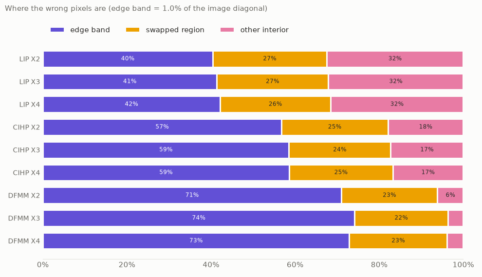
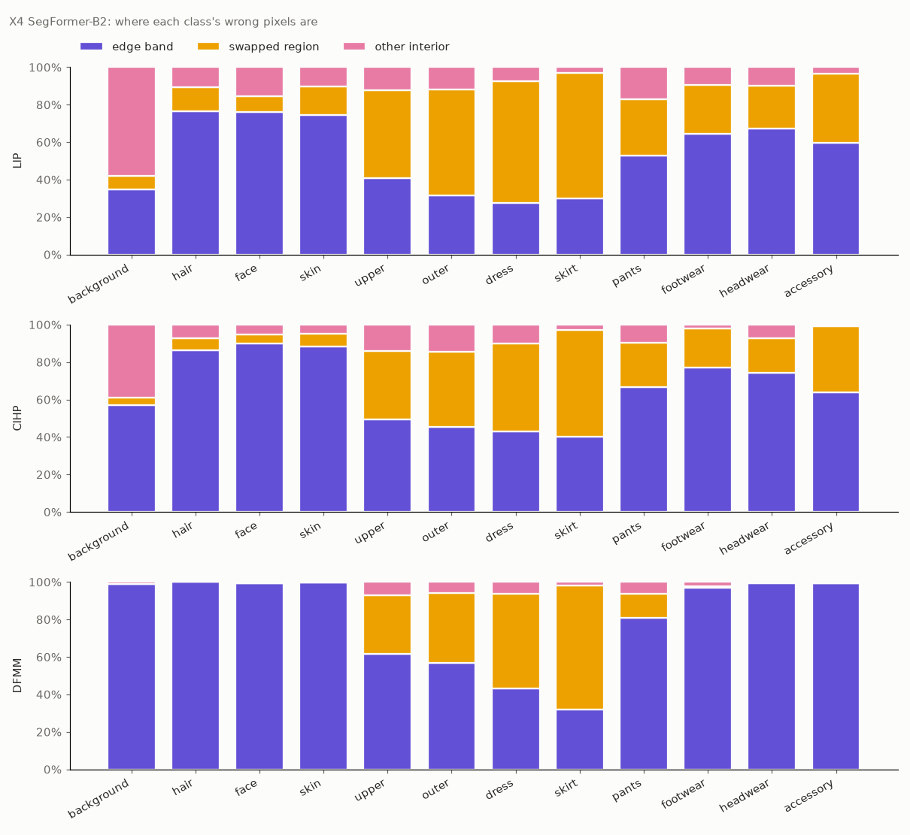
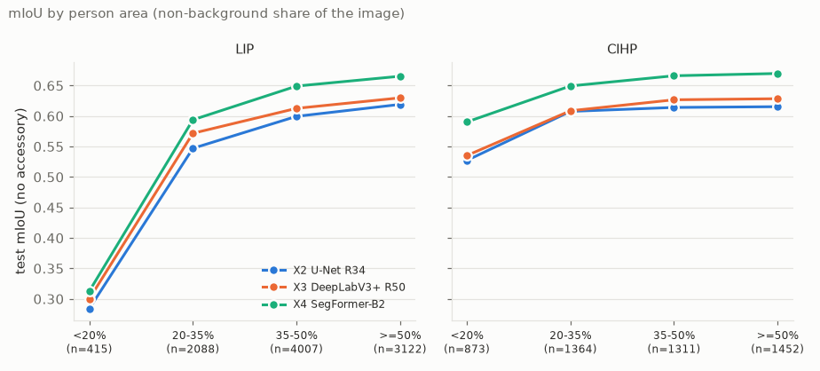
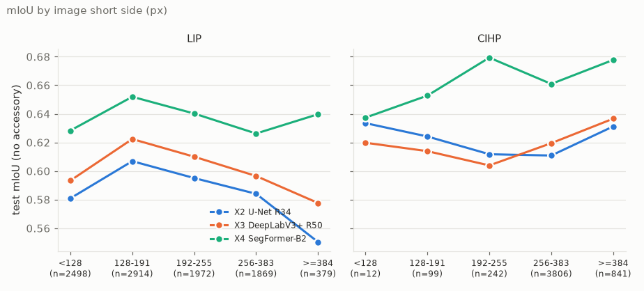
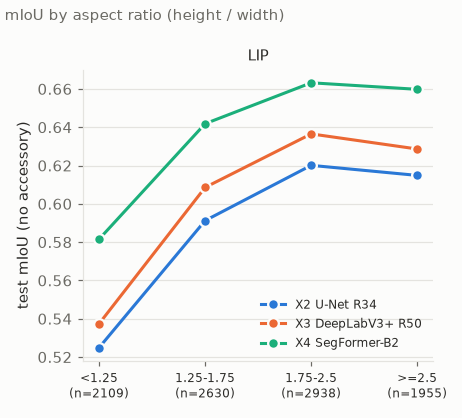

# T10 — Error analysis และข้อจำกัด

## In plain words
บนรูปทั่วไป (LIP, CIHP) ความผิดพลาดของเสื้อผ้าส่วนใหญ่คือ **ให้ป้ายผิดทั้งชิ้น** (เช่น เสื้อคลุมกลายเป็นเสื้อ) ไม่ใช่ขอบไม่คม ส่วนบน DFMM ความผิดพลาดส่วนใหญ่อยู่ที่ขอบ คนตัวเล็กในภาพเป็นตัวที่ทำให้คะแนนตกมากที่สุด ส่วนความละเอียดของภาพมีผลน้อย
การตรวจ label `dress` ของ CIHP พบว่าบนรูปทั่วไป label ถูกเกือบทั้งหมด แต่ในรูปที่ทุกโมเดลพลาด (17.7% ของรูปที่มี dress) ส่วนใหญ่เป็นรูปที่ถูกครอปหรือชุดซ้อนหลายชิ้นซึ่งตัดสินยาก maintainer ตัดสินให้เขียนเป็นข้อจำกัด (d5)
รายงานนี้รวมข้อจำกัดทั้งหมดของโปรเจกต์ไว้ในที่เดียว (หัวข้อ 5) สำหรับ T11

## ข้อมูลที่ใช้

- **run:** X2 `20261105-1307-1acb88f-unet-r34`, X3 `20261105-2050-f4e2ffe-deeplabv3p-r50`, X4 `20261105-2220-ac9a26b-segformer-b2` (`splits-v2-d023252b81d9`, `eval-v2`, checkpoint step 40000)
- **error zones:** `scripts/error_zones.py configs/report/t10.yaml` ใช้ GPU ทายทุกรูปของทั้งสาม test set ใหม่ (ถือ GPU lock 16 นาที) ใช้ขั้นตอนทายเดียวกับ `evaluate.py` (ไม่ได้แก้) ผลอยู่ที่ `data/analysis/T10/zones/` ผลรวมของทุก zone ตรงกับ confusion matrix ใน `metrics.json` ทุกช่องสำหรับ X2 และ X3 ส่วน X4 ต่างกันไม่เกิน 5,092 พิกเซลในช่องเดียว เพราะ `metrics.json` ของ X4 มาจาก RTX 3060 แต่รอบนี้รันบน RTX 4070 (เหมือน M10)
- **คะแนนตามขนาดและรูปทรงของภาพ:** จำนวนพิกเซลรายรูปของ M10 (`data/review/M10/breakdown/`) ไม่ใช้ GPU
- **ตรวจ label `dress` ของ CIHP:** `configs/review/t10.yaml` + `notebooks/review/visual_review.py` คำตัดสินอยู่ใน `docs/reports/2026-11-07-T10-verdicts.csv` (maintainer) และ `docs/reports/2026-11-07-T10-verdicts-second.csv` (ผู้ดูคนที่สองซึ่งเป็น AI)

สร้างตัวเลขและกราฟใหม่ได้ด้วย `uv run python scripts/t10_results.py configs/report/t10.yaml` ตัวเลขทุกตัวในรายงานนี้มาจาก `docs/reports/2026-11-07-T10-results.json` ส่วน `docs/reports/2026-11-07-T10-tables.md` มีตารางครบ

## 1. ผิดตรงไหน: ขอบ, ทั้งชิ้น หรือด้านใน

### วิธีแบ่ง
ทุกพิกเซลที่ทายผิดถูกจัดเข้าหนึ่งในสาม zone:

- **ขอบ (edge band):** อยู่ใกล้เส้นแบ่งระหว่างคลาสใน ground truth ไม่เกินระยะหนึ่ง ระยะนี้คิดเป็นสัดส่วนของเส้นทแยงมุมของภาพ ค่าหลักคือ 1% (รูป LIP ราว 2–5 พิกเซล, CIHP ราว 6 พิกเซล, DFMM 13 พิกเซล) และลองที่ 0.5% กับ 2% ด้วย เพื่อดูว่าข้อสรุปไม่ได้ขึ้นกับค่าที่เลือก
- **ให้ป้ายผิดทั้งชิ้น (swapped region):** ไม่อยู่ที่ขอบ และอยู่ในพื้นที่ต่อเนื่องของคลาสหนึ่งใน ground truth ที่โมเดลทายเป็นคลาสอื่นเป็นส่วนใหญ่ เช่น เสื้อคลุมทั้งตัวถูกทายเป็น `upper`
- **ด้านในอื่น ๆ (other interior):** ที่เหลือ คือพื้นที่ส่วนใหญ่ถูก แต่มีบางจุดข้างในผิด

### ผล (ขอบ 1%)

| test set | ขอบ | ให้ป้ายผิดทั้งชิ้น | ด้านในอื่น ๆ |
|---|---|---|---|
| LIP | 40–42% | 26–27% | 32% |
| CIHP | 57–59% | 24–25% | 17–18% |
| DFMM | 71–74% | 22–23% | 4–6% |

(ช่วงคือค่าต่ำสุดถึงสูงสุดของสามโมเดล ค่าแยกตามโมเดลอยู่ในไฟล์ตาราง)

- **ทั้งสามโมเดลมีสัดส่วนใกล้กันมาก** สิ่งที่ต่างคือจำนวนพิกเซลที่ผิด ไม่ใช่ว่าผิดแบบไหน
- **ลำดับ LIP < CIHP < DFMM ไม่เปลี่ยนตามระยะขอบ:** ที่ 0.5% ขอบเป็น 26–28% / 40–43% / 62–66% และที่ 2% เป็น 58–59% / 74–75% / 83–85%
- **DFMM:** รูปสตูดิโอ คนเดียว พื้นหลังเรียบ ความผิดพลาดส่วนใหญ่จึงเหลือแค่ที่ขอบ
- **LIP:** ผิดด้านในมากที่สุด (32%) ส่วนใหญ่เป็นคลาส `background` ซึ่ง 58% ของพิกเซลที่ผิดอยู่ด้านใน (X4) คือโมเดลทายพื้นหลังที่อยู่ไกลจากคนเป็นคลาสของคน **ยังไม่ได้ตรวจว่าเพราะอะไร** สมมติฐานหนึ่งคือ LIP ติด label แค่คนเดียวต่อรูป คนอื่นในรูปจึงเป็น background แต่ยังไม่ได้ดูรูปยืนยัน

### แยกตามคลาส (X4)

- **ผม หน้า และผิว:** 75–100% ของพิกเซลที่ผิดอยู่ที่ขอบ คือหาเจอแล้ว แต่ขอบยังไม่แม่น
- **เสื้อผ้า:** สัดส่วนที่ให้ป้ายผิดทั้งชิ้นของ `upper` / `outer` / `dress` / `skirt` คือ 47% / 57% / 65% / 67% บน LIP, 37% / 40% / 47% / 57% บน CIHP และ 31% / 37% / 51% / 66% บน DFMM ปัญหาหลักของคลาสเสื้อผ้าคือ **เลือกป้ายผิด** ไม่ใช่ขอบไม่คม ซึ่งสอดคล้องกับ M10 ที่พบว่า label ของเสื้อผ้าบางแบบกำกวม

### ชิ้นที่ให้ป้ายผิดบ่อยที่สุด

คิดเป็นสัดส่วนของพิกเซลที่ผิดทั้งหมด ทุกโมเดลได้อันดับคล้ายกัน:

- **LIP และ CIHP:** `outer` → `upper` 4.8–5.6% และ `upper` → `outer` 3.8–5.7% เป็นสองอันดับแรกในทุกโมเดล ตามด้วย `dress` → `upper` 1.2–1.6%
- **DFMM:** `upper` → `outer` 3.1–3.8% และการสลับกันระหว่าง `outer`, `dress` และ `skirt` (2.1–3.2% ต่อคู่)

M10 (d4) ตัดสินแล้วว่า `outer` ↔ `upper` นับเป็นความผิดของโมเดล คู่นี้จึงเป็นจุดที่ควรปรับปรุงโมเดลมากที่สุด

### ถ้าไม่นับขอบ ลำดับโมเดลยังเหมือนเดิมไหม

mIoU ไม่นับ `accessory` เมื่อตัดแถบขอบ 1% ออก (เหมือนเป็น IGNORE):

| test set | X2 | X3 | X4 |
|---|---|---|---|
| LIP | 0.5924 → 0.6368 | 0.6071 → 0.6547 | 0.6399 → 0.6865 |
| CIHP | 0.6185 → 0.6887 | 0.6262 → 0.7054 | 0.6682 → 0.7411 |
| DFMM | 0.8257 → 0.9103 | 0.8245 → 0.9201 | 0.8635 → 0.9344 |

| ความต่าง | LIP ทั้งหมด → ไม่นับขอบ | CIHP | DFMM |
|---|---|---|---|
| X4 − X2 | +0.047 → +0.050 | +0.050 → +0.052 | +0.038 → +0.024 |
| X4 − X3 | +0.033 → +0.032 | +0.042 → +0.036 | +0.039 → +0.014 |
| X3 − X2 | +0.015 → +0.018 | +0.008 → +0.017 | −0.001 → +0.010 |

- **บน LIP และ CIHP X4 ยังนำห่างเท่าเดิม** ข้อได้เปรียบของ X4 ไม่ได้มาจากขอบ แต่มาจากการเลือกป้ายถูกกว่า
- **บน DFMM ข้อได้เปรียบของ X4 ส่วนใหญ่มาจากขอบ** ถ้าไม่นับขอบ X4 นำ X3 แค่ +0.014
- **X3 แย่ที่สุดที่ขอบ** ถ้าไม่นับขอบ X3 นำ X2 มากขึ้นในทุก test set ซึ่งเข้ากับการที่ DeepLabV3+ (output stride 16) ทายที่ความละเอียดต่ำกว่า U-Net แต่การวิเคราะห์นี้ยังไม่ได้พิสูจน์สาเหตุ

## 2. คะแนนตามขนาดและรูปทรงของภาพ

M1, M2 และ T3 ขอไว้ แต่ละกลุ่มรวมจำนวนพิกเซลของรูปในกลุ่มแล้วคิดเหมือนเป็น test set หนึ่งชุด DFMM ไม่ได้แยกเพราะรูปขนาดเท่ากันหมด (1101 × 750) และมีคนเดียวขนาดใกล้กัน

### ขนาดคน (สัดส่วนพิกเซลที่ไม่ใช่พื้นหลัง)

| test set | คน < 20% | 20–35% | 35–50% | ≥ 50% |
|---|---|---|---|---|
| LIP (รูป) | 415 | 2088 | 4007 | 3122 |
| LIP X2 / X3 / X4 | 0.284 / 0.300 / 0.313 | 0.547 / 0.572 / 0.594 | 0.600 / 0.613 / 0.649 | 0.619 / 0.630 / 0.665 |
| CIHP (รูป) | 873 | 1364 | 1311 | 1452 |
| CIHP X2 / X3 / X4 | 0.527 / 0.535 / 0.590 | 0.608 / 0.609 / 0.649 | 0.614 / 0.627 / 0.666 | 0.615 / 0.628 / 0.670 |

**ปัจจัยที่ส่งผลมากที่สุด:** รูป LIP ที่คนกินพื้นที่ไม่ถึง 20% ได้ mIoU แค่ 0.28–0.31 ครึ่งหนึ่งของรูปที่คนใหญ่ บน CIHP ผลลดลงน้อยกว่า (0.53–0.59) X4 ดีที่สุดในทุกกลุ่ม

### ความละเอียดของภาพ (ด้านสั้น) และสัดส่วนของภาพ

- **ด้านสั้นของภาพมีผลน้อย:** บน LIP X4 อยู่ระหว่าง 0.626–0.652 ในทุกกลุ่ม และไม่ได้เพิ่มตามขนาด CIHP มีรูปเล็กแค่ 12 และ 99 รูปในสองกลุ่มแรก จึงอ่านกลุ่มนั้นไม่ได้
- **LIP รูปกว้าง (สูง/กว้าง < 1.25) แย่ที่สุด:** 0.525 / 0.537 / 0.582 เทียบกับ 0.620 / 0.637 / 0.663 ของรูปทรงสูง (1.75–2.5) รูป LIP ถูกครอปรอบคนหนึ่งคน รูปกว้างจึงมักเป็นท่านั่ง ท่าก้ม หรือครอปครึ่งตัว ข้อนี้เป็นการตีความ ยังไม่ได้ตรวจ และอาจเกี่ยวกับขนาดคนข้างต้น (สองอย่างนี้ไม่ได้แยกออกจากกัน)

## 3. ตรวจ label `dress` ของ CIHP (d5)

**ทำไมต้องตรวจ:** ในรูปตัวอย่างของ T9 พบรูปที่ CIHP ติด `dress` ให้เสื้อตัวบนและเสื้อกาวน์ และทุกโมเดลทายเป็น `upper` หรือ `outer` จากรูป CIHP 936 รูปที่มี `dress` มี 166 รูป (17.7%, รวมเป็น 9.2% ของพิกเซล `dress`) ที่ทั้งสามโมเดลหา `dress` เจอไม่ถึง 10% ตัวเลขนี้บอกไม่ได้ว่าเป็น label ผิดหรือโมเดลผิด

**วิธี:** ใช้เครื่องมือของ M10 เลือก 24 รูป: 12 รูปที่ X4 หา `dress` เจอน้อยที่สุด (10 รูปในนั้นทั้งสามโมเดลหาเจอไม่ถึง 10%) และ 12 รูปสุ่ม คำตัดสิน: W = label ผิด, G = ชุดก้ำกึ่ง (`dress` พอรับได้), M = ชุดเดรสชัดเจน (ถ้าพลาดคือโมเดลผิด), A = บอกไม่ได้ maintainer ตัดสินทั้ง 24 รูป แล้วให้ AI (Claude subagent) ดูรูปชุดเดียวกันอีกรอบโดยไม่เห็นคำตัดสินเดิม แล้ว maintainer แก้ 5 รูปหลังเห็นการอ่านรอบที่สอง (แต่ละรูปมีโน้ตบอกไว้)

| คำตัดสิน | maintainer: แย่สุด | สุ่ม | AI: แย่สุด | สุ่ม |
|---|---|---|---|---|
| W label ผิด | 4 | 1 | 2 | 1 |
| G ก้ำกึ่ง | 4 | 2 | 4 | 3 |
| M เดรสชัดเจน | 3 | 9 | 0 | 8 |
| A บอกไม่ได้ | 1 | 0 | 6 | 0 |

คำตัดสินตรงกัน 18 จาก 24 รูป (แย่สุด 7, สุ่ม 11) ก่อนแก้ตรงกัน 13 จาก 24 ทั้ง 6 รูปที่ยังต่างกันเป็นรูปที่ถูกครอป maintainer ตัดสินจากแบบของชุด ส่วน AI ใช้กฎเคร่งว่า "มองไม่เห็นช่วงล่าง = บอกไม่ได้"

**สิ่งที่ทั้งสองรอบเห็นตรงกัน:**
- **บนรูปทั่วไป label ถูกเกือบทั้งหมด:** 11 จาก 12 รูปสุ่มเป็นเดรสชัดเจนหรือก้ำกึ่ง
- **ใน 12 รูปที่ X4 พลาดที่สุด เดรสชัดเจนมีน้อย:** 3 จาก 12 (maintainer) หรือ 0 (AI) ที่เหลือเป็นรูปครอปครึ่งตัว ชุดซ้อนหลายชิ้นที่ติดเป็น `dress` ชิ้นเดียว (เช่น เอี๊ยมทับเสื้อ, เสื้อกั๊กทับกระโปรง) เสื้อคลุมยาวหรือชุดยูนิฟอร์ม และ label ผิดบางส่วน (2–4 รูป)
- **ข้อสรุป:** 17.7% ของรูปที่ทุกโมเดลพลาดส่วนใหญ่เป็นกรณีที่ตัดสินยาก ไม่ใช่ความผิดของโมเดลอย่างเดียว และไม่ใช่ label ผิดอย่างเดียว ตัวเลขนี้ใช้เป็นอัตราที่แม่นยำไม่ได้ เพราะมีแค่ 12 รูปต่อกลุ่ม และสองรอบเห็นต่างกันในรูปครอป

**การตัดสินของ maintainer (d5):** เขียนเป็นข้อจำกัด ไม่แก้ label และไม่เทรนใหม่

## 4. Error analysis รายคลาส: ความผิดของข้อมูลหรือของโมเดล

รวมผลจาก T9 (confusion matrix), M10 (d1–d4) และ T10 (zones, d5):

| คลาส | อาการหลัก | ส่วนที่มาจากข้อมูล | ส่วนที่เป็นความผิดของโมเดล |
|---|---|---|---|
| `outer` ↔ `upper` | ให้ป้ายผิดทั้งชิ้น สองอันดับแรกบน LIP/CIHP | บางชิ้นกำกวม (เสื้อเปิดหน้า, คาร์ดิแกน; M10 Q4) | ส่วนใหญ่ (d4) |
| `dress` (LIP) | IoU 0.30–0.40, → `upper` 18–22% | jumpsuit ถูก map เป็น `dress` (d1) แต่ไม่ใช่สาเหตุหลัก (T9) | เดรสจริงของ LIP ก็หาเจอแค่ 55–60% |
| `dress` (CIHP) | 17.7% ของรูปที่มี dress ทุกโมเดลพลาด | รูปครอป ชุดซ้อน เสื้อคลุมยาว label ผิดบางรูป (d5) | เดรสชัดเจนที่พลาด (ส่วนน้อยในกลุ่มที่พลาด) |
| `skirt` | IoU ต่ำสุดใน LIP/CIHP, → `pants`/`dress` | กระโปรงที่ดูเหมือนกางเกงขาสั้น และ skirt กับ dress ที่แยกไม่ออก (d3) | กระโปรงที่ชัดเจน (d3) |
| `footwear` (CIHP) | → `background` 21–28% | socks มักเป็นถุงน่อง (d2) และรองเท้าตัวเล็กมาก | ส่วนที่เหลือ (X4 หาเจอมากกว่าชัดเจน) |
| ผม หน้า ผิว | 75–100% ของที่ผิดอยู่ที่ขอบ | - | ขอบไม่แม่น |
| `accessory` | X2 แทบหาไม่เจอบน CIHP/DFMM | คลาสเล็กและหายากมาก (M6) ไม่นับใน mIoU หลัก | X3/X4 เรียนได้ X2 ไม่ได้ |

## 5. ข้อจำกัดทั้งหมด

### ข้อมูลและ label
- **การรวมคลาส:** ชุด label ร่วม 12 คลาสรวม raw class หลายแบบเข้าด้วยกัน (M5) ข้อมูลแต่ละชุดจึงมีความหมายของคลาสไม่ตรงกันทีเดียว
- **jumpsuit ของ LIP เป็น `dress`** แต่ CIHP ติด jumpsuit เป็น `upper` + `pants` (d1) คะแนนเพิ่มของ T9 ตัดได้เฉพาะฝั่ง test
- **socks ของ CIHP อยู่ใน `footwear`** และส่วนใหญ่เป็นถุงน่องหรือถุงเท้ายาว (d2)
- **skirt กับ dress และกระโปรงที่ดูเหมือนกางเกงขาสั้น** แยกกันไม่ได้ชัด (d3)
- **`dress` ของ CIHP** มีรูปครอป ชุดซ้อน และ label ผิดบางรูป (d5)
- **ไม่ได้ใช้ ATR** (D2) และไม่ได้ใช้ Fashionpedia, DeepFashion2 (scope)

### Test set
- **ใช้ official val ของ LIP/CIHP เป็น test** เพราะไม่มี label ของ official test (D4)
- **คะแนนเทียบกับงานตีพิมพ์ไม่ได้:** ตัดรูปที่ annotation ล้มเหลว (mask เป็นพื้นหลังทั้งรูป) และรูปเล็กหรือผอมเกินไปออก LIP test จึงเหลือ 9,632 รูปแทน 10,000 (M1, M2)
- **LIP test ต่างจาก train:** test มีรูปเต็มตัวมากกว่า (`pants` อยู่ใน 84% ของรูป test เทียบกับ 52% ของ train, `footwear` 55% เทียบกับ 31%) มาจาก split ทางการ ไม่ใช่การตัดของเรา (T3) คะแนน val ของ LIP จึงอาจต่างจาก test

### การเทรนและความยุติธรรมของการเทียบ
- **ใช้ lr ร่วม 1e-4 ทุกโมเดล** ไม่ได้ใช้สูตรต้นฉบับของแต่ละโมเดล (SegFormer ต้นฉบับใช้ 6e-5, head ×10 และไม่ใช้ weight decay กับ norm) และไม่ได้จูนแยกโมเดล (T7, T8) ผลของการเลือกนี้ยังไม่รู้
- **budget 40k step และทุกโมเดลได้ `best.pt` ที่ step สุดท้าย** (M7) โมเดลยังดีขึ้นอยู่ตอนหยุด ผลนี้คือการเทียบที่ budget เท่ากัน ไม่ใช่ความสามารถสูงสุด
- **โมเดลละ 1 run (1 seed):** ช่วง bootstrap ของ T9 ครอบคลุมแค่การสุ่มรูป test X3 − X2 (+0.007) เล็กพอที่ seed อื่นอาจกลับลำดับได้
- **X4 เทรนบน GPU คนละรุ่น** (RTX 3060 แทน RTX 4070) เวลาเทรนจึงเทียบกันไม่ได้ และตัวเลขที่คำนวณใหม่ของ X4 ต่างจาก `metrics.json` เล็กน้อย (IoU ไม่เกิน 0.00044, T9)

### การวิเคราะห์นี้
- **ระยะขอบเลือกเอง:** ใช้ 1% ของเส้นทแยงมุมเป็นหลัก ลองที่ 0.5% และ 2% แล้ว ลำดับไม่เปลี่ยน แต่สัดส่วนเปลี่ยนมาก (เช่น DFMM 62–85%) ตัวเลขสัดส่วนจึงขึ้นกับนิยาม
- **"ให้ป้ายผิดทั้งชิ้น" คิดจากพื้นที่ต่อเนื่องของคลาสใน ground truth** ถ้าคนสองคนใส่เสื้อติดกัน จะนับเป็นพื้นที่เดียว
- **การตรวจ label ใช้แค่ 24 รูป** ผู้ดูที่เป็นคนมีคนเดียว ผู้ดูคนที่สองเป็น AI ที่เห็นพิกเซลเดียวกัน ไม่ใช่ผู้ติด label อิสระ
- **ขนาดคนกับสัดส่วนภาพไม่ได้แยกจากกัน** และเป็นค่าต่อรูป รูป CIHP มีหลายคน

## สิ่งที่ยังไม่รู้

- ทำไม LIP ผิดที่พื้นหลังด้านในมาก (สมมติฐาน: คนอื่นในรูปที่ไม่ได้ติด label ยังไม่ได้ตรวจ) → **ตอบแล้วใน M11:** ส่วนใหญ่เป็นคนอื่นที่ LIP ไม่ได้ติด label ดู [`2026-11-08-M11-lip-multiperson.md`](2026-11-08-M11-lip-multiperson.md)
- ถ้าใช้ lr ตามสูตรต้นฉบับ หรือเทรนนานกว่า 40k ลำดับและระยะห่างจะเปลี่ยนไหม
- X3 แย่ที่ขอบเพราะ output stride จริงไหม

## งานต่อ

- **T11:** สไลด์ใช้ `figures/T10/error_zones.png`, `error_zones_per_class.png` และ `buckets_person_share.png` ได้เลย ข้อจำกัดในหัวข้อ 5 ใช้เป็นสไลด์ข้อจำกัดได้ตรง ๆ
- **นอก T10 (เสนอ):** ตรวจพื้นหลังด้านในของ LIP ด้วยรูปตัวอย่าง, ทำ E3 (CE + Dice) หรือ loss ที่เน้นขอบถ้าอยากลดความผิดที่ขอบบน DFMM
