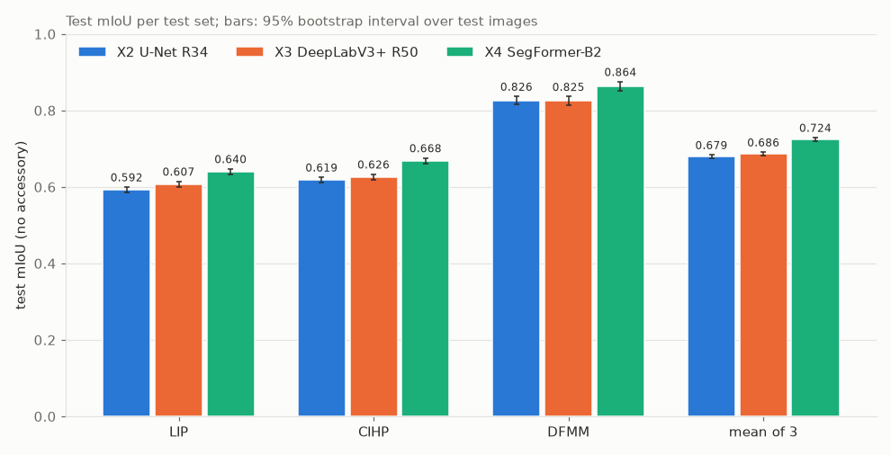
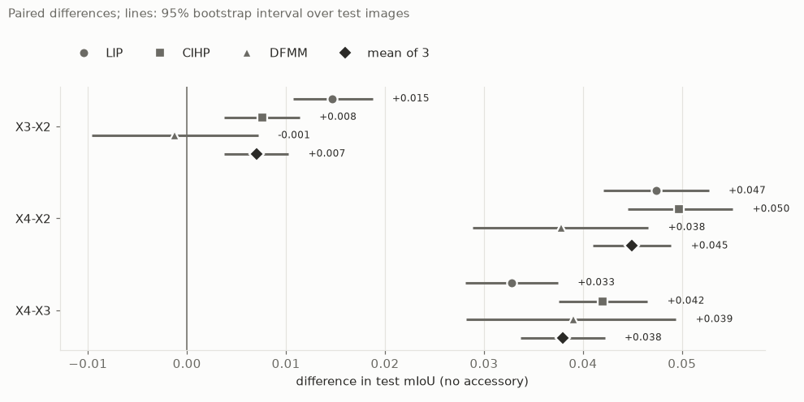
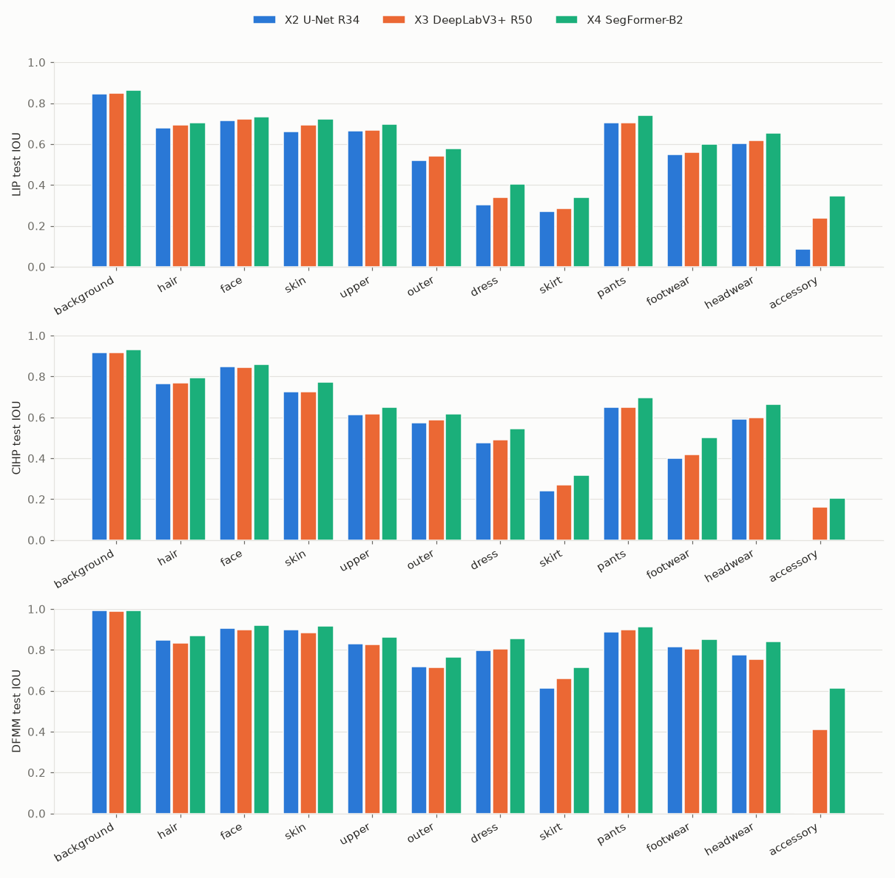
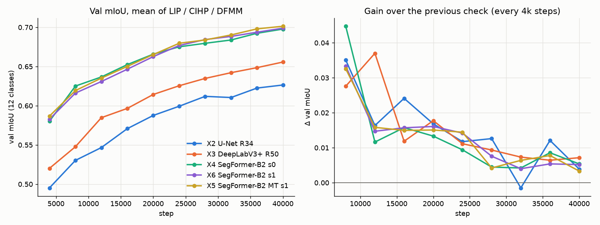
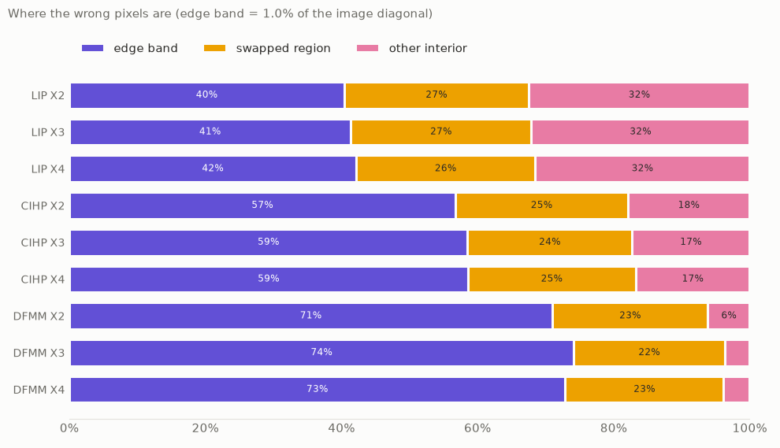
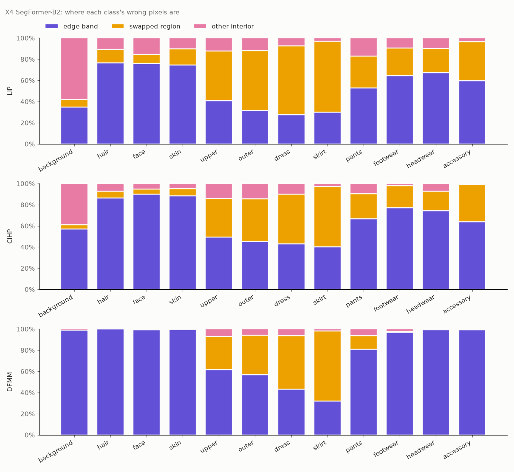
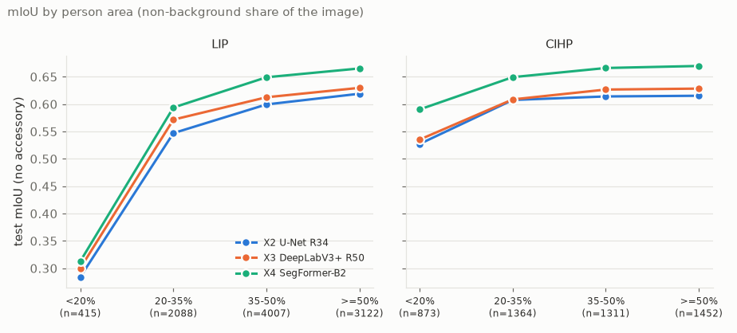

# รายงานสรุปโปรเจกต์ ณ วันปิดงาน (M12): Clothing-centric Human Parsing

วันที่ตัดยอด: 2026-11-09 · branch `main` ที่ commit `0437268` (หลัง merge PR #32) · ผู้เขียน: lemasc (ร่างโดย Claude)

> **เอกสารนี้คือจุดเริ่มต้นสำหรับทุกคนในทีม** ใช้เตรียมสไลด์ (T11), README และตอบคำถามตอนนำเสนอ
> เรียงตามลำดับการนำเสนอ ไม่ได้เรียงตามเวลา ถ้าผลเก่าถูกแทนที่แล้ว ในเนื้อหาจะใช้ผลล่าสุดเท่านั้น ประวัติอยู่ในภาคผนวก B
> ตัวเลขทุกตัวคัดมาจาก report และไฟล์ JSON ที่ลิงก์ไว้ ไม่มีค่าประมาณ ตัวเลขใหม่ในเอกสารนี้มีชุดเดียว คือกราฟการเทรน (หัวข้อ 5.6) ซึ่งสร้างจาก `scripts/m12_curves.py`

## สารบัญ

0. [สรุปสั้น](#0-สรุปสั้น)
1. [ปัญหาและเป้าหมาย](#1-ปัญหาและเป้าหมาย)
2. [ข้อมูล](#2-ข้อมูล)
3. [วิธีการและการตั้งค่าการทดลอง](#3-วิธีการและการตั้งค่าการทดลอง)
4. [การ implement](#4-การ-implement)
5. [ผลลัพธ์](#5-ผลลัพธ์)
6. [Error analysis](#6-error-analysis)
7. [ข้อจำกัด](#7-ข้อจำกัด)
8. [งานในอนาคต](#8-งานในอนาคต)
9. [วิธีสร้างผลซ้ำ (reproduce)](#9-วิธีสร้างผลซ้ำ-reproduce)
- ภาคผนวก: [A ดัชนีงาน](#a-ดัชนีงาน-task--handoff--report) · [B ประวัติและผลที่ถูกแทนที่](#b-ประวัติและผลที่ถูกแทนที่) · [C อภิธานศัพท์](#c-อภิธานศัพท์) · [D คำถามที่อาจถูกถาม](#d-คำถามที่อาจถูกถาม)

---

## 0. สรุปสั้น

- **งาน:** ทำ semantic segmentation ระดับพิกเซลของเสื้อผ้าและส่วนของร่างกาย (human parsing) ด้วยชุด label ร่วม 12 คลาส บนข้อมูล 3 ชุด: LIP, CIHP และ DeepFashion-MultiModal (DFMM)
- **โมเดล:** เทียบ 3 สถาปัตยกรรมอย่างเป็นธรรม (CNN ถึง Transformer) คือ U-Net R34, DeepLabV3+ R50 และ SegFormer-B2 ทุกตัวใช้ข้อมูล, split, ความละเอียด, augmentation และงบ 40k step เท่ากัน
- **ผลหลัก:** SegFormer-B2 ดีที่สุดทุก test set และทุกคลาส test mIoU (11 คลาส ไม่นับ `accessory`) เฉลี่ยสามชุด: **SegFormer 0.7239**, DeepLabV3+ 0.6859, U-Net 0.6789 ช่วงความเชื่อมั่น 95% ของความต่าง SegFormer กับอีกสองตัวไม่คร่อม 0
- **Multi-task (4 คะแนนตาม rubric):** SegFormer-B2 ที่เพิ่ม attribute head 12 ตัว (X5) ทำนาย attribute ของ DFMM ได้ macro-F1 **0.8036** (การทายคลาสที่พบมากสุดได้ 0.3310) และ segmentation ไม่แย่ลง (ต่างจาก X6 ไม่เกิน 0.0009 mIoU ต่อ test set)
- **ข้อจำกัดหลัก 3 ข้อ:**
  1. label ของแต่ละชุดข้อมูลขัดกันบางจุด (เช่น LIP ติด label คนเดียวต่อภาพ, CIHP ติดทุกคน)
  2. ทุกโมเดลยังดีขึ้นอยู่ตอนหยุดที่ 40k step ผลนี้คือการเทียบที่งบเท่ากัน ไม่ใช่ความสามารถสูงสุด
  3. โมเดลละ 1 seed (ยกเว้น SegFormer มี 2) ความต่าง DeepLabV3+ กับ U-Net (+0.007) เล็กพอที่ seed อื่นอาจกลับลำดับได้
- **งานที่เหลือ:** T11 (สไลด์และ README) ส่วนงานต่อยอดอยู่ในหัวข้อ 8

---

## 1. ปัญหาและเป้าหมาย

- **ปัญหา:** ทำนาย mask ระดับพิกเซลของภาพคน ให้แต่ละพิกเซลเป็นหนึ่งใน 12 คลาส (พื้นหลัง, ส่วนของร่างกาย, ประเภทเสื้อผ้า, เครื่องประดับ)
- **ทำไมรวมหลายชุดข้อมูล (D1):** แต่ละชุดมีจุดแข็งต่างกัน LIP เป็นภาพครอปคนเดียวจากภาพทั่วไป CIHP เป็นภาพหลายคน DFMM เป็นภาพสตูดิโอแฟชั่นและมี attribute label เราจึง map ทั้งสามชุดเข้าชุด label เดียว
- **เป้าหมาย:**
  1. เทียบ 3 สถาปัตยกรรมอย่างเป็นธรรม (D5)
  2. ประเมินบน test set ที่แยกไว้ ด้วย mIoU, IoU รายคลาส และ Dice
  3. วิเคราะห์ข้อผิดพลาดและข้อจำกัด
  4. ต่อยอดเป็น multi-task: segmentation + attribute ของ DFMM (E1)
- **Rubric:** segmentation ได้ 3 คะแนนความยาก multi-task ได้ 4 คะแนน ถ้ามีอย่างน้อย 2 งานเรียนร่วมกันในโมเดลเดียว และรายงานผลแยกแต่ละงาน ([`assignment-rubric.md`](../assignment-rubric.md))

ที่มา: [`PLAN.md`](../PLAN.md) (Goal, D1–D9), [kickoff](../handoffs/2026-11-03-kickoff.md)

---

## 2. ข้อมูล

### 2.1 ชุดข้อมูลที่ใช้และไม่ใช้

| ชุดข้อมูล | ลักษณะ | label ที่มี | แหล่ง |
|---|---|---|---|
| LIP | ภาพครอปคนเดียวจากภาพทั่วไป ภาพเล็ก (~270×130) | 19 คลาส + bg, official train 30,462 / val 10,000 | <https://github.com/Yukun-Huang/Single-Human-Parsing-LIP> |
| CIHP | ภาพทั่วไป หลายคนต่อภาพ (~333–375×500) | 19 คลาส + bg, official train 28,280 / val 5,000 | <https://github.com/Engineering-Course/CIHP_PGN> |
| DFMM | ภาพสตูดิโอแฟชั่น คนเดียว เต็มตัว (1101×750) | 23 คลาส + bg (12,701 mask), attribute รูปทรง/ผ้า/ลาย | <https://github.com/yumingj/DeepFashion-MultiModal> |

- **official test ของ LIP และ CIHP ไม่มี label** จึงใช้ official val เป็น test (D4)
- **ไม่ใช้:**
  - ATR: ไม่มีคลาส coat/outer ขัดกับชุด label ร่วม (D2)
  - Fashionpedia, DeepFashion2, DressCode: อยู่นอก scope (Fashionpedia เป็นงานต่อยอด E4)
- พื้นหลังเป็น 53% (LIP), 61% (CIHP), 77% (DFMM) ของพิกเซล คลาสเล็ก เช่น เข็มขัด แว่นกันแดด ถุงมือ ผ้าพันคอ และถุงเท้า มีชนิดละประมาณ 0.1% ของพิกเซล (คลาสไม่สมดุลมาก)

ที่มา: [kickoff](../handoffs/2026-11-03-kickoff.md), [T1](../handoffs/2026-11-03-T1-lemasc.md)

### 2.2 ชุด label ร่วม (`labels-v1`)

| # | คลาสร่วม | LIP | CIHP | DFMM |
|---|---|---|---|---|
| 0 | background | 0 | 0 | 0 |
| 1 | hair | 2 | 2 | 13 |
| 2 | face | 13 | 13 | 14 |
| 3 | skin | 14–17 | 10, 14–17 | 15 |
| 4 | upper | 5 | 5 | 1 |
| 5 | outer | 7 | 7 | 2 |
| 6 | dress / one-piece | 6, 10 | 6 | 4, 21 |
| 7 | skirt | 12 | 12 | 3 |
| 8 | pants | 9 | 9 | 5 |
| 9 | footwear | 8, 18, 19 | 8, 18, 19 | 6, 11, 18 |
| 10 | headwear | 1 | 1 | 7 |
| 11 | accessory | 3, 4, 11 | 3, 4, 11 | 8, 9, 19, 23 |
| 255 | ignore | – | – | 10, 12, 16, 17, 20, 22 |

- ตัวเลขคือ raw ID ของแต่ละชุดข้อมูล คลาสซ้าย/ขวา (แขน ขา รองเท้า) ถูกรวมกัน การ flip ภาพจึงไม่ต้องสลับ label
- **ID 10 ของ LIP กับ CIHP มีความหมายต่างกัน:** LIP คือ jumpsuit (→ `dress`), CIHP คือ torso-skin (→ `skin`)
- **`accessory` เป็นของผสม:** ถุงมือใน LIP, ผ้าพันคอใน CIHP, แว่นและของที่คอใน DFMM (M5) จึงไม่นับใน mIoU หลัก (หัวข้อ 3.4)
- สัดส่วนที่ raw class แต่ละตัวส่งให้คลาสร่วม: notebook `notebooks/eda/t1_eda.py` หัวข้อ 4b (M5)

ที่มา: [T2](../handoffs/2026-11-03-T2-lemasc.md), [M5](../handoffs/2026-11-05-M5-lemasc.md), [M6](2026-11-05-M6-accessory-check.md)

### 2.3 การคัดข้อมูลออก (ใช้กฎเดียวกันกับ train, val และ test)

- **mask ว่าง:** mask ที่มีแต่พื้นหลังคือ annotation ล้มเหลว (ตรวจด้วยตาครบ 28 ภาพใน LIP test ทุกภาพมีคนใส่เสื้อผ้าชัดเจน) ตัดออกทุก split (M1, D4)
- **ภาพเล็กหรือผอมเกิน:** ด้านสั้น < 64 px หรือสัดส่วนด้าน > 6:1 ตัดออกทุก split มีผลกับ LIP เท่านั้น (M2)
- **รั่วไหลไปยัง test:** ภาพ train ที่อยู่กลุ่มเดียวกับภาพ test ถูกตัดออก (หัวข้อ 2.4)

### 2.4 การแบ่งข้อมูลและการป้องกันข้อมูลรั่ว (leakage)

- **test:** LIP และ CIHP ใช้ official val; DFMM ใช้ 10% ของ outfit
- **val:** LIP/CIHP 5% ของกลุ่มใน train; DFMM 10% ของ outfit เลือกด้วย hash ของ group key ที่มี seed จึงไม่ขึ้นกับลำดับแถว
- **group split:**
  - DFMM: แบ่งตาม outfit ID เพราะ 1 outfit มีหลายมุมกล้อง (12,701 mask แต่มีเพียง 6,902 ID)
  - LIP: กลุ่มตามภาพต้นฉบับ (ID `<photo>_<person>`) **พบว่า official train กับ val ของ LIP ใช้ภาพต้นฉบับร่วมกัน** 2,508 ภาพ train ครอปมาจากภาพที่อยู่ใน val ด้วย
- **near-duplicate:** dHash 64-bit (รวมภาพกลับด้าน) ระยะ ≤ 6 แล้วยืนยันด้วย correlation ของ thumbnail 32×32 (≥ 0.70 สำหรับ LIP/CIHP, ≥ 0.98 ถ้าคู่มี DFMM) เก็บได้ 991 คู่ กลุ่มที่เชื่อมกันถูกรวม (union-find) และภาพ train ที่อยู่กลุ่มเดียวกับ test ถูกตัดออก
- **ข้อจำกัดของการตรวจ:** dHash ไม่จับภาพครอป ถ้า LIP ครอปจากภาพ CIHP จะไม่เจอ (ไม่พบคู่ซ้ำแบบเต็มภาพหรือย่อขนาดระหว่าง LIP กับ CIHP)

**จำนวนภาพ (`splits-v2-d023252b81d9`):**

| ชุดข้อมูล | train | val | test | ตัดออก (เหตุผล) |
|---|---|---|---|---|
| LIP | 25,653 | 1,358 | 9,632 | 3,819 (leak 2,276 · เล็ก 1,399 · mask ว่าง 105 · ผอม 39) |
| CIHP | 26,667 | 1,420 | 5,000 | 193 (leak) |
| DFMM | 10,180 | 1,228 | 1,293 | 0 |
| **รวม** | **62,500** | **4,006** | **15,925** | 4,012 |

- DFMM test มาจาก 708 outfit ที่ไม่อยู่ใน train
- **LIP test ต่างจาก train ตั้งแต่ต้นทาง:** test มีภาพเต็มตัวมากกว่า (`pants` อยู่ใน 84% ของภาพ test เทียบกับ 52% ของ train) มาจาก official split ไม่ใช่จากการตัดของเรา
- ตรวจ threshold ด้วยตาได้ใน `notebooks/eda/t3_duplicates.py`

ที่มา: [T3](../handoffs/2026-11-03-T3-lemasc.md), [M1](../handoffs/2026-11-04-M1-lemasc.md), [M2](../handoffs/2026-11-04-M2-lemasc.md), `data/splits/splits-v2/meta.json`

### 2.5 ปัญหา label ที่รู้แล้ว (รายละเอียดในหัวข้อ 6 และ 7)

| เรื่อง | สรุป | ที่มา |
|---|---|---|
| LIP ติด label คนเดียวต่อภาพ | คนอื่นในภาพเป็น background ส่วน CIHP ติดทุกคน | M11 |
| jumpsuit | LIP map เป็น `dress`, CIHP ติดเป็น `upper` + `pants` | M10 d1 |
| socks ของ CIHP | อยู่ใน `footwear` แต่ส่วนใหญ่เป็นถุงน่องหรือถุงเท้ายาว | M10 d2 |
| skirt กับ dress | กระโปรงที่ดูเหมือนกางเกงขาสั้น และ skirt/dress ที่แยกไม่ออก | M10 d3 |
| `dress` ของ CIHP | มีภาพครอป ชุดซ้อน และ label ผิดบางภาพ | T10 d5 |
| `accessory` | คลาสผสมและหายาก (DFMM มี 0.02% ของพิกเซล) | M5, M6 |
| เข็มขัด | เป็นเสื้อผ้าใน LIP/CIHP แต่ ignore ใน DFMM | T2 |

---

## 3. วิธีการและการตั้งค่าการทดลอง

### 3.1 สามโมเดลที่เทียบ

| | U-Net | DeepLabV3+ | SegFormer-B2 |
|---|---|---|---|
| ประเภท | CNN encoder-decoder มี skip connection | CNN + atrous (dilated) conv | Transformer (MiT-B2) + all-MLP decoder |
| encoder (ImageNet pretrained) | ResNet-34 | ResNet-50 | MiT-B2 |
| output stride | 32 (decoder ขยายกลับเต็มขนาด) | 16 | logits ที่ 1/4 แล้ว upsample |
| พารามิเตอร์ | 24.4M | 26.7M | 27.4M |
| Run | X2 | X3 | X4 (และ X6 seed 1) |

- ขนาดโมเดลใกล้กัน (24–27M) จึงเทียบกันที่สถาปัตยกรรม ไม่ใช่ที่ขนาด
- SegFormer ตั้งค่าให้ตรงกับต้นฉบับใน 3 จุดที่ค่า default ของไลบรารีต่าง: decoder กว้าง 768, `Dropout2d(0.1)` ก่อน classifier และ upsample แบบ `align_corners=False` (T8)

ที่มา: [T6](../handoffs/2026-11-04-T6-amonwan.md), [T7](../handoffs/2026-11-05-T7-YavittaTH.md), [T8](../handoffs/2026-11-05-T8-ritsupaintblu.md)

### 3.2 การเทียบที่เป็นธรรม (D5)

ค่าที่ **เหมือนกันทุกโมเดล** (`configs/base.yaml`):

| ค่า | ตั้งไว้ |
|---|---|
| ข้อมูล | `splits-v2-d023252b81d9`, LIP + CIHP + DFMM, สุ่มตามสัดส่วนจริง (~41/43/16%) |
| input | 512×512 |
| augmentation (train เท่านั้น) | scale ด้านยาว 0.5–2.0 แล้วครอปสุ่ม 512, flip แนวนอน 0.5, color jitter 0.2 |
| batch / งบ | batch 8, 40,000 step (ประมาณ 5 epoch ของ 62,500 ภาพ) |
| optimizer | AdamW, lr 1e-4, weight decay 0.01, warmup 1,500 step แล้วลดแบบ poly (power 1) จนเป็น 0 ที่ step 40000 |
| loss | cross-entropy ข้ามพิกเซล IGNORE |
| precision | bf16 AMP |
| encoder | ImageNet pretrained ทุกตัว |
| การเลือก checkpoint | ค่าเฉลี่ย val mIoU ของ 3 ชุดข้อมูล ตรวจทุก 4,000 step |

ค่าที่ **ไม่ได้จูนแยกโมเดล โดยตั้งใจ:** lr 1e-4 ใช้ร่วมกัน ไม่ได้ใช้สูตรต้นฉบับของแต่ละโมเดล (เช่น SegFormer ใช้ 6e-5, head lr ×10) เพราะสูตรนั้นต้องตั้ง optimizer แยกกลุ่ม ซึ่งโมเดลอื่นไม่ได้ (T8) ผลของการเลือกนี้ยังไม่รู้ (หัวข้อ 7)

### 3.3 การตัดสินเรื่องงบ 40k step (ปิด M7)

- **ที่มา:** M7 ล็อกงบไว้ที่ 40k และตั้งเงื่อนไขว่า "ถ้า `best.pt` ของ X3 อยู่ที่ step 40000 อีก ให้พิจารณาใหม่"
- **สิ่งที่เกิด:** เงื่อนไขเกิดขึ้นแล้ว `best.pt` ของทุก run (X2–X6) อยู่ที่ step 40000 และ val ยังขึ้นอยู่ (หัวข้อ 5.6)
- **การตัดสิน (M12):** **คงงบ 40k** ผลทั้งหมดเป็นการเทียบที่งบเท่ากัน และเขียนเป็นข้อจำกัด ส่วนการเทรน 80k ย้ายไปเป็นงานในอนาคต (หัวข้อ 8)
- **เหตุผล:**
  - ช่องว่างระหว่างโมเดลบน val ใหญ่กว่าการเพิ่มขึ้นช่วงท้ายมาก (หัวข้อ 5.6) ลำดับจึงไม่น่าเปลี่ยน
  - lr ลดเป็น 0 ที่ step สุดท้าย การได้ `best.pt` ที่ step สุดท้ายจึงเป็นเรื่องปกติของ schedule นี้ และบอกไม่ได้ว่า 80k จะดีขึ้นเท่าไร
  - ถ้าเปลี่ยนงบ ต้องเทรนใหม่ทั้งสามโมเดล และทำ T9, T10, M10, M11 ใหม่ทั้งหมด

### 3.4 Protocol การประเมิน (`eval-v2`, frozen)

- **วัดที่ความละเอียดเดิมของ mask:** ย่อด้านยาวเป็น 512, pad, ทำนาย แล้วครอปและขยาย logits กลับเป็นขนาดเดิม
- **IoU = TP / (TP + FP + FN)** ต่อคลาส คิดจาก confusion matrix ของ **ทั้ง test set** (รวมพิกเซลทุกภาพ ไม่ใช่เฉลี่ยรายภาพ) **Dice = 2TP / (2TP + FP + FN)** ซึ่ง = 2·IoU / (1 + IoU) ลำดับโมเดลในแต่ละคลาสจึงเหมือนกับ IoU เสมอ
- **ตัวชี้วัดหลัก (headline): mIoU 11 คลาส ไม่นับ `accessory`** (M6) เพราะ `accessory` เป็นคลาสผสมและหายาก รายงาน mIoU 12 คลาสคู่กันเสมอ
- **ค่าเฉลี่ยสามชุด:** เฉลี่ย mIoU ของ LIP, CIHP, DFMM ให้น้ำหนักเท่ากัน (ภาพ DFMM ใหญ่กว่า LIP ราว 11 เท่า ถ้ารวมพิกเซล DFMM จะครองคะแนน; M3)
- **ช่วงความเชื่อมั่น 95%:** paired bootstrap สุ่มภาพ test แบบใส่คืน 2,000 ครั้ง ทุกโมเดลใช้ภาพชุดเดียวกันในแต่ละรอบ ช่วงนี้ครอบคลุมเฉพาะความแกว่งจากการสุ่มภาพ test ไม่รวมความแกว่งจาก seed
- **attribute (`attr-v1`):** accuracy และ macro-F1 ต่อ head บน DFMM test นับเฉพาะคลาสที่มีอย่างน้อย 20 ภาพ เทียบกับ baseline ที่ทายคลาสที่พบมากสุดเสมอ

> **ใช้ตัวเลขไหนบนสไลด์:** ใช้ **mIoU 11 คลาส** เป็นหลัก (ตาราง T9 และหัวข้อ 5.1) report ของ X5/X6 ใช้ mIoU 12 คลาสเป็นหลัก ถ้ายกตัวเลขจากที่นั่น ให้ระบุว่าเป็น 12 คลาสทุกครั้ง

ที่มา: [M3](../handoffs/2026-11-05-M3-lemasc.md), [M6](../handoffs/2026-11-05-M6-lemasc.md), [T9](2026-11-07-T9-evaluation.md)

### 3.5 Multi-task (E1)

- **โมเดล:** SegFormer-B2 ตัวเดิม บวก attribute head บน feature ชั้นลึกสุดของ encoder ตัวเดียวกัน (encoder ร่วมกันสองงาน)
- **12 head:** sleeve, lower_length, socks, hat, glasses, neckwear, wrist, ring, waist_acc, neckline, outer_cardigan, covers_navel (attribute รูปทรงของ DFMM) ไม่ใช้ attribute ผ้าและลาย เพราะเบ้มาก และ outer มี NA 80%
- **loss:** `L = L_seg + 0.1 · L_attr` (0.1 ไม่ได้จูน) ภาพ LIP/CIHP ไม่มี attribute ค่าเป้าหมายจึงเป็น IGNORE และไม่ส่ง gradient ให้ head
- **การเลือก checkpoint:** ใช้ segmentation อย่างเดียว (กฎเดียวกับ X4)
- **การเทียบ:** X5 (multi-task, seed 1) กับ X6 (SegFormer ธรรมดา, seed 1) บน GPU เดียวกัน ต่างกันแค่ head

ที่มา: [E1](../handoffs/2026-11-08-E1-claude.md), [X5/X6 handoff](../handoffs/2026-11-08-X5-X6-lemasc.md)

### 3.6 ทะเบียน run

| ID | โมเดล | run folder | config hash | seed | GPU | เวลาเทรน | `best.pt` |
|---|---|---|---|---|---|---|---|
| X2 | U-Net R34 | `20261105-1307-1acb88f-unet-r34` | `d4f03d515ed0` | 0 | RTX 4070 | 1.15 ชม. | 40000 |
| X3 | DeepLabV3+ R50 | `20261105-2050-f4e2ffe-deeplabv3p-r50` | `8d71807da489` | 0 | RTX 4070 | 1.22 ชม. | 40000 |
| X4 | SegFormer-B2 | `20261105-2220-ac9a26b-segformer-b2` | `8e9039649376` | 0 | RTX 3060 | 4.15 ชม. | 40000 |
| X5 | SegFormer-B2 + attribute | `20261108-1152-2ed6c81-segformer-b2-mt` | `0d5871d12a05` | 1 | RTX 4070 | 2.34 ชม. | 40000 |
| X6 | SegFormer-B2 | `20261108-1434-adf7cd7-segformer-b2-s1` | `aaaf45d6418b` | 1 | RTX 4070 | 2.33 ชม. | 40000 |

- ทุก run ใช้ `splits-v2-d023252b81d9` และ `eval-v2`
- X1 (U-Net baseline แรก) ถูกแทนที่ด้วย X2 (ภาคผนวก B)
- run folder อยู่บน shared mount `runs/` (ไม่อยู่ใน git) แต่ละ folder มี `meta.json`, `log.jsonl`, checkpoint และ `eval/`

---

## 4. การ implement

ส่วนนี้ตอบคำถาม "ทำอย่างไร" ตอนนำเสนอ โค้ดทั้งหมดอยู่ใน `src/cloth_segment/` ส่วน `scripts/` เป็นตัวเรียกบาง ๆ

### 4.1 ภาพรวม pipeline

```
datasets/ (ภาพและ mask ดิบ)
  │  scripts/prepare_masks.py      ← data/labels.py  (raw ID → คลาสร่วม)
  ▼
data/masks/labels-v1/ (mask 12 คลาส + stats.csv)
  │  scripts/build_splits.py       ← data/splits.py, data/dedup.py
  ▼
data/splits/splits-v2/manifest.csv (หนึ่งแถวต่อภาพ: split, กลุ่ม, จำนวนพิกเซล, attribute)
  │  data/dataset.py + data/transforms.py
  ▼
python -m cloth_segment.train configs/<exp>.yaml   ← models/, runs.py
  ▼
runs/<datetime>-<commit>-<slug>/ (meta.json, log.jsonl, best.pt)
  │  python -m cloth_segment.evaluate <run>        (+ attr_eval สำหรับ X5)
  ▼
runs/<run>/eval/eval-v2/<dataset>/metrics.json
  │  scripts/t9_results.py, t10_results.py, m11_results.py, m12_curves.py
  ▼
docs/reports/ (ตาราง, JSON, กราฟ)
```

### 4.2 การแปลง label (`data/labels.py`, `scripts/prepare_masks.py`)

- `MAPPING_BY_NAME` เก็บตาราง raw → คลาสร่วมของแต่ละชุดข้อมูลไว้ที่เดียว ถ้ามี raw label ที่ไม่ได้ map ไว้ import จะล้มทันที
- `convert()` ใช้ lookup table และ raise error ถ้าเจอค่าที่ไม่รู้จัก จึงไม่มี label ผิดหลุดเข้าไปเงียบ ๆ
- แปลงครั้งเดียว (86,443 mask, ~25 วินาที) แล้วเก็บเป็น PNG loader ไม่แปลงซ้ำ ผลมี version (`labels-v1`) และ hash

### 4.3 การป้องกัน leakage (`data/dedup.py`, `data/splits.py`)

- `dedup.py`: dHash 64-bit ของภาพและภาพกลับด้าน → หาคู่ที่ Hamming distance ≤ 6 → ยืนยันด้วย correlation ของ thumbnail 32×32
- `splits.py`: group key (ภาพต้นฉบับ LIP, outfit ID ของ DFMM) → รวมกลุ่มที่ซ้ำกันด้วย union-find → กลุ่มที่มีภาพ test ห้ามมีภาพใน train → แบ่ง val ด้วย hash ที่มี seed
- `build_splits.py` ตรวจ invariant ของ leakage ก่อนเขียน และไม่ยอมเขียนทับถ้าเนื้อหาต่าง

### 4.4 โมเดล (`models/`)

- ทั้งสามโมเดลสร้างจากไลบรารีเดียวกัน คือ `segmentation_models_pytorch` (smp) โดยใช้ encoder ที่ pretrained บน ImageNet
- แต่ละโมเดลลงทะเบียนด้วย `@register("<name>")` และ config เลือกด้วย `model.name` ทุกโมเดลคืน logits `[B, 12, H, W]` เหมือนกัน
- `PadToMultiple` pad input ให้หารด้วย output stride ลงตัว (32 หรือ 16) แล้วครอป output กลับ จึงรับภาพทุกขนาดได้
- **ตอบคำถาม "เทียบอย่างไรให้ยุติธรรม":** ไลบรารีเดียว, interface เดียว, training loop เดียว และ config ส่วนที่ใช้ร่วมกันเหมือนกันทุกโมเดล ต่างกันแค่ `model.*`

### 4.5 Training loop (`train.py`)

- โหลด config: `base.yaml` + config ของการทดลอง (deep merge) → ค่าทุกตัวถูก hash
- AdamW, warmup แบบ linear แล้วลดแบบ poly จนเป็น 0, bf16 autocast, ตั้ง seed ก่อนสร้างโมเดลเพื่อให้ค่าเริ่มต้นของ decoder/head เหมือนเดิม (M4)
- ตรวจ val ทุก 4,000 step เก็บ mIoU แยกแต่ละชุดข้อมูล และบันทึก `best.pt` ตามค่าเฉลี่ยของสามชุด

loss ของ segmentation (คิดที่ขนาด mask และข้ามพิกเซล IGNORE):

```python
def loss_fn(logits, target, loss_cfg):
    logits = logits_at(logits, target.shape[-2:])
    return F.cross_entropy(logits.float(), target, ignore_index=IGNORE)
```

ตัวอย่าง config ของการทดลอง (`configs/unet_r34.yaml`) ทุกอย่างที่เหลือมาจาก `base.yaml`:

```yaml
model:
  name: unet_r34
  pretrained: true
```

### 4.6 Multi-task (`models/multitask.py`, `attributes.py`)

- `AttrHead`: นำ feature ชั้นลึกสุดของ encoder มาทำ mean-pool และ max-pool ต่อกัน → Linear 256 + GELU + dropout → classifier หนึ่งตัวต่อ attribute
- `forward_multi` ใช้ encoder ครั้งเดียวและได้ผลลัพธ์สองงาน:

```python
def forward_multi(self, x):
    features = self.net.encoder(self.pad(x))  # encoder ร่วม
    masks = self.net.segmentation_head(self.net.decoder(features))
    return self.restore(masks, ...), self.attr_head(features[-1])
```

- loss รวม: `L_seg + 0.1 · L_attr` ค่า attribute ที่เป็น NA, ไม่มี label หรือมาจากภาพที่ไม่ใช่ DFMM ถูกตั้งเป็น IGNORE จึงไม่ได้ gradient

### 4.7 การประเมิน (`evaluate.py`)

- ทำนายที่ 512 แล้ว `restore_logits` ครอปส่วนที่ pad ออกและขยายกลับเป็นขนาดเดิมของ mask
- confusion matrix ของทั้ง test set สะสมด้วย `bincount` และข้าม IGNORE จากนั้น IoU และ Dice คิดจาก matrix นี้:

```python
keep = target != IGNORE
idx = target[keep] * num_classes + pred[keep]
cm = torch.bincount(idx, minlength=num_classes**2).reshape(num_classes, num_classes)
```

- raise error ถ้า mask มีค่านอกช่วง จึงไม่มี mask ผิดถูกนับคะแนน
- protocol นี้เป็น shared contract ที่ `frozen` การเปลี่ยนต้องเป็น PR `frozen-change` และ bump version (ทำครั้งเดียวคือ M3: `eval-v1` → `eval-v2`)

### 4.8 การติดตาม run และความถูกต้องของผล (`runs.py`)

- ชื่อ run = `<datetime>-<commit>-<slug>` ตั้งตอนเริ่ม
- **config hash เป็น cache key:** ถ้ามี run ที่จบแล้วด้วย hash เดียวกัน `train.py` จะไม่เทรนซ้ำ (D7)
- `meta.json` บันทึก commit, สถานะ dirty, data version, จำนวนพารามิเตอร์, ชื่อ GPU, หน่วยความจำ และ driver (M4, M9)
- **GPU lock:** เครื่องเดียวใช้ร่วมกันหลายคน งาน GPU ต้องถือ lock ก่อน (D9)
- **test:** 302 test (297 เดิม + 5 ของ M12) รันได้โดยไม่ต้องมีข้อมูลจริงและไม่ใช้ GPU และ ruff บังคับผ่าน pre-commit

---

## 5. ผลลัพธ์

### 5.1 ผลหลัก: test mIoU 11 คลาส (ไม่นับ `accessory`) พร้อมช่วง 95%

| test set | ภาพ | U-Net (X2) | DeepLabV3+ (X3) | SegFormer-B2 (X4) |
|---|---|---|---|---|
| LIP | 9,632 | 0.5924 (0.585–0.600) | 0.6071 (0.600–0.615) | **0.6399** (0.632–0.647) |
| CIHP | 5,000 | 0.6185 (0.611–0.625) | 0.6262 (0.619–0.633) | **0.6682** (0.660–0.676) |
| DFMM | 1,293 | 0.8257 (0.815–0.837) | 0.8245 (0.813–0.836) | **0.8635** (0.852–0.875) |
| เฉลี่ยสามชุด | – | 0.6789 (0.674–0.684) | 0.6859 (0.681–0.691) | **0.7239** (0.719–0.729) |



ตัวชี้วัดอื่น (ค่าเฉลี่ยสามชุด):

| run | mIoU 12 คลาส | mIoU 11 คลาส | mDice 12 คลาส | mDice 11 คลาส | pixel acc |
|---|---|---|---|---|---|
| X2 | 0.6248 | 0.6789 | 0.7307 | 0.7922 | 0.9064 |
| X3 | 0.6513 | 0.6859 | 0.7671 | 0.7990 | 0.9088 |
| X4 | 0.6959 | 0.7239 | 0.8036 | 0.8277 | 0.9202 |

ตารางเต็มรายชุด: [`2026-11-07-T9-tables.md`](2026-11-07-T9-tables.md)

### 5.2 ความต่างแบบจับคู่ และความน่าเชื่อถือของลำดับ

| คู่ | LIP | CIHP | DFMM | เฉลี่ย |
|---|---|---|---|---|
| X4 − X2 | +0.0474 (+0.042 ถึง +0.053) | +0.0497 (+0.045 ถึง +0.055) | +0.0378 (+0.029 ถึง +0.047) | +0.0450 (+0.041 ถึง +0.049) |
| X4 − X3 | +0.0328 (+0.028 ถึง +0.037) | +0.0420 (+0.038 ถึง +0.047) | +0.0390 (+0.028 ถึง +0.049) | +0.0379 (+0.034 ถึง +0.042) |
| X3 − X2 | +0.0146 (+0.011 ถึง +0.019) | +0.0077 (+0.004 ถึง +0.011) | −0.0012 (−0.010 ถึง +0.007) | +0.0070 (+0.004 ถึง +0.010) |



- **SegFormer นำแน่นอน:**
  - ช่วง 95% ไม่คร่อม 0 ในทุก test set และนำทุกคลาสในทุก test set (36 จาก 36 คู่)
  - SegFormer สอง seed บนสอง GPU (X4, X6) ต่างกันไม่เกิน 0.0021 test mIoU (หัวข้อ 5.6) ซึ่งเล็กกว่าระยะนำ (~0.038) มาก
- **DeepLabV3+ นำ U-Net นิดเดียว และยังไม่แน่นอน:**
  - +0.007 เฉลี่ย, บน DFMM เท่ากัน
  - ช่วง 95% ครอบคลุมแค่การสุ่มภาพ test ไม่ครอบคลุม seed ซึ่งยังไม่ได้วัดสำหรับสองโมเดลนี้
  - ถ้านับ 12 คลาส ความต่างดูใหญ่กว่า (+0.027) เพราะ U-Net แทบหา `accessory` ไม่เจอบน CIHP และ DFMM

### 5.3 IoU รายคลาสและ confusion matrix

| class | LIP X2 | LIP X3 | LIP X4 | CIHP X2 | CIHP X3 | CIHP X4 | DFMM X2 | DFMM X3 | DFMM X4 |
|---|---|---|---|---|---|---|---|---|---|
| background | 0.8448 | 0.8506 | **0.8629** | 0.9175 | 0.9181 | **0.9314** | 0.9923 | 0.9906 | **0.9935** |
| hair | 0.6807 | 0.6923 | **0.7048** | 0.7656 | 0.7682 | **0.7934** | 0.8476 | 0.8352 | **0.8679** |
| face | 0.7157 | 0.7225 | **0.7327** | 0.8476 | 0.8463 | **0.8608** | 0.9060 | 0.8979 | **0.9193** |
| skin | 0.6624 | 0.6940 | **0.7234** | 0.7267 | 0.7254 | **0.7732** | 0.8981 | 0.8856 | **0.9164** |
| upper | 0.6632 | 0.6695 | **0.6985** | 0.6127 | 0.6181 | **0.6489** | 0.8290 | 0.8258 | **0.8615** |
| outer | 0.5217 | 0.5417 | **0.5760** | 0.5742 | 0.5873 | **0.6187** | 0.7194 | 0.7145 | **0.7634** |
| dress | 0.3040 | 0.3405 | **0.4038** | 0.4750 | 0.4890 | **0.5452** | 0.7988 | 0.8036 | **0.8550** |
| skirt | 0.2701 | 0.2863 | **0.3405** | 0.2427 | 0.2691 | **0.3153** | 0.6140 | 0.6612 | **0.7142** |
| pants | 0.7025 | 0.7043 | **0.7409** | 0.6486 | 0.6512 | **0.6978** | 0.8867 | 0.8978 | **0.9143** |
| footwear | 0.5499 | 0.5586 | **0.6007** | 0.4014 | 0.4170 | **0.5023** | 0.8144 | 0.8034 | **0.8531** |
| headwear | 0.6016 | 0.6175 | **0.6543** | 0.5918 | 0.5982 | **0.6629** | 0.7768 | 0.7540 | **0.8400** |
| accessory | 0.0850 | 0.2394 | **0.3476** | 0.0022 | 0.1619 | **0.2041** | 0.0007 | 0.4120 | **0.6118** |



- **คลาสที่ยากเหมือนกันทุกโมเดล:** `skirt` และ `dress` บน LIP/CIHP (IoU 0.24–0.55), `footwear` บน CIHP และ `outer`
- **ความสับสนหลักเป็นคู่เดิมทุกโมเดล:** skirt → pants/dress, dress → upper, outer → upper, footwear → background SegFormer ลดทุกคู่ แต่ไม่หาย
- **DFMM ง่ายกว่ามาก** (0.82–0.86 เทียบกับ 0.59–0.67) เพราะเป็นภาพสตูดิโอ คนเดียว ยืนเต็มตัว พื้นหลังเรียบ
- confusion matrix: [`figures/T9/confusion_lip.png`](figures/T9/confusion_lip.png), [`confusion_cihp.png`](figures/T9/confusion_cihp.png), [`confusion_dfmm.png`](figures/T9/confusion_dfmm.png) Dice รายคลาส: [`figures/T9/dice_per_class.png`](figures/T9/dice_per_class.png)

### 5.4 ภาพตัวอย่าง (ทำนายถูกและผิด)

- แต่ละ test set มี 8 ภาพ: 5 ภาพสุ่ม และ 3 ภาพที่ SegFormer หาเสื้อผ้าเจอน้อยที่สุด แต่ละคอลัมน์คือ ภาพ, ground truth และผลทำนายของสามโมเดล พร้อม mIoU ของภาพนั้น
- **ภาพมาจากชุดข้อมูล จึงไม่อยู่ใน git:** อยู่บน shared mount ที่ `data/review/T9/figures/qualitative_{lip,cihp,dfmm}.jpg` สร้างใหม่ได้ด้วย `scripts/t9_qualitative.py` (หัวข้อ 9) ตรวจสิทธิ์การใช้ภาพ (licence) ก่อนใส่ในสไลด์
- **สิ่งที่เห็น:**
  - ภาพสุ่มส่วนใหญ่ ทั้งสามโมเดลทายใกล้กัน ต่างกันที่ขอบและชิ้นเล็ก (รองเท้า หมวก มือ)
  - ภาพที่แย่ที่สุดเกือบทั้งหมดเป็นการ **สลับคลาสเสื้อผ้าทั้งชิ้น** ไม่ใช่หาคนไม่เจอ เช่น LIP #6415, #7962, #4506 ที่ GT เป็น `outer` แต่ทุกโมเดลทายเป็น `upper`
  - SegFormer ไม่ได้ดีกว่าในทุกภาพ เช่น DFMM #411 (เดรสสีเข้มทรงหลวม ทายเป็น `outer`)

ที่มา: [T9 หัวข้อ "รูปตัวอย่าง"](2026-11-07-T9-evaluation.md)

### 5.5 Multi-task: สองงานในโมเดลเดียว

**งานที่ 1: segmentation** (X5 multi-task เทียบกับ X6 ธรรมดา seed เดียวกัน GPU เดียวกัน, test mIoU 12 คลาส)

| test set | X6 (ธรรมดา) | X5 (multi-task) | X5 − X6 |
|---|---|---|---|
| LIP | 0.6156 | 0.6154 | −0.0002 |
| CIHP | 0.6312 | 0.6305 | −0.0007 |
| DFMM | 0.8404 | 0.8394 | −0.0009 |
| เฉลี่ย 12 คลาส / 11 คลาส | 0.6957 / 0.7241 | 0.6951 / 0.7234 | −0.0006 / −0.0007 |

**งานที่ 2: attribute** (X5 บน DFMM test, `attr-v1`)

| head | ภาพ | accuracy | macro-F1 | baseline accuracy | baseline macro-F1 |
|---|---|---|---|---|---|
| sleeve | 1,291 | 0.9357 | 0.7953 | 0.4183 | 0.1475 |
| lower_length | 1,288 | 0.9255 | 0.7779 | 0.5054 | 0.1679 |
| socks | 1,240 | 0.9282 | 0.7265 | 0.8895 | 0.3138 |
| hat | 1,275 | 0.9945 | 0.9884 | 0.8620 | 0.4629 |
| glasses | 1,272 | 0.9969 | 0.9828 | 0.9513 | 0.4875 |
| neckwear | 1,242 | 0.8164 | 0.7872 | 0.6618 | 0.3983 |
| wrist | 1,272 | 0.8994 | 0.8967 | 0.5692 | 0.3627 |
| ring | 1,207 | 0.8003 | 0.7306 | 0.6877 | 0.4075 |
| waist_acc | 1,291 | 0.8552 | 0.6020 | 0.5515 | 0.1777 |
| neckline | 1,094 | 0.7331 | 0.4530 | 0.6188 | 0.1529 |
| outer_cardigan | 1,161 | 0.9733 | 0.9608 | 0.7821 | 0.4389 |
| covers_navel | 1,178 | 0.9686 | 0.9423 | 0.8345 | 0.4549 |
| **เฉลี่ย 12 head** | | **0.9023** | **0.8036** | 0.6943 | 0.3310 |

baseline = ทายคลาสที่พบมากสุดเสมอ

- **ทั้งสองงานเรียนได้ในโมเดลเดียว** และรายงานแยกกัน ตรงตามเงื่อนไข multi-task ของ rubric
- **ไม่เสีย ไม่ได้:** segmentation ต่างจาก X6 ไม่เกิน 0.0009 ซึ่งเล็กกว่าความต่างระหว่าง seed (X4 กับ X6 ต่างได้ถึง 0.0021) จึงพูดได้ว่า "ไม่เห็นผลเสีย" แต่พูดไม่ได้ว่า "ช่วย"
- **ต้นทุนต่ำ:** พารามิเตอร์เพิ่ม 272,166 ตัว (1.0%) เวลาเทรนต่างกัน 0.3%
- **ดู macro-F1 ไม่ใช่ accuracy:** เช่น `glasses` ทายคลาสหลักอย่างเดียวก็ได้ accuracy 0.95 แล้ว
- **head ที่ยาก:** `neckline` (0.4530) และ `waist_acc` (0.6020) คลาส `belt`, `standing` (คอตั้ง) และ `v` (คอวี) แทบทายไม่ถูก

ที่มา: [X5](2026-11-08-X5-segformer-b2-mt.md), [X6](2026-11-08-X6-segformer-b2-seed1.md)

### 5.6 การตรวจความทนทานของผล

**(ก) seed และ GPU:** X4 (seed 0, RTX 3060) กับ X6 (seed 1, RTX 4070) ใช้ config เดียวกันยกเว้น seed

| test set | X4 | X6 | X6 − X4 |
|---|---|---|---|
| LIP | 0.6155 | 0.6156 | +0.0001 |
| CIHP | 0.6295 | 0.6312 | +0.0017 |
| DFMM | 0.8425 | 0.8404 | −0.0021 |
| เฉลี่ย 12 คลาส | 0.6959 | 0.6957 | −0.0002 |

- เปลี่ยนทั้ง GPU และ seed พร้อมกัน ผลขยับไม่เกิน 0.002 GPU จึงไม่กระทบการเทียบ แต่แยกไม่ได้ว่าส่วนไหนมาจาก GPU ส่วนไหนมาจาก seed
- การวัด X4 ซ้ำบน RTX 4070 ได้ IoU ต่างจาก `metrics.json` ไม่เกิน 0.00044 (T9 cross-check)

**(ข) โมเดลยังดีขึ้นอยู่ที่ 40k หรือไม่** (ใหม่ใน M12: [`2026-11-09-M12-curves.md`](2026-11-09-M12-curves.md))



val mIoU (12 คลาส, เฉลี่ยสามชุด) ช่วงท้าย:

| run | 32k | 36k | 40k | +36k→40k | train loss ช่วงสุดท้าย |
|---|---|---|---|---|---|
| X2 U-Net | 0.6105 | 0.6226 | 0.6264 | +0.0039 | 0.4023 |
| X3 DeepLabV3+ | 0.6421 | 0.6486 | 0.6557 | +0.0071 | 0.3755 |
| X4 SegFormer s0 | 0.6838 | 0.6924 | 0.6978 | +0.0054 | 0.3089 |
| X6 SegFormer s1 | 0.6884 | 0.6938 | 0.6989 | +0.0052 | 0.3068 |
| X5 SegFormer MT s1 | 0.6903 | 0.6980 | 0.7014 | +0.0033 | 0.3286 (*) |

(*) loss ของ X5 รวม attribute loss ด้วย จึงเทียบตรงกับ run อื่นไม่ได้ ค่าทุกตัวในตารางนี้มาจาก [`2026-11-09-M12-curves.md`](2026-11-09-M12-curves.md)

- **สัญญาณว่ายังเทรนไม่อิ่ม:** ทุก run ยังขึ้นอยู่ตอนจบ ไม่มีสัญญาณ overfitting (train loss ยังลด val ยังขึ้น) และ 40k step คือแค่ประมาณ 5 epoch
- **แต่ยังสรุปไม่ได้ว่าเทรนนานขึ้นจะดีขึ้นเท่าไร:** lr ลดเป็น 0 ที่ step 40000 การได้ผลเพิ่มช่วงท้ายส่วนหนึ่งมาจาก lr ที่ลดลง ต้องเทรน 80k จริงจึงจะรู้
- **ลำดับไม่น่าเปลี่ยน:** บน val SegFormer นำ DeepLabV3+ ~0.042 และ DeepLabV3+ นำ U-Net ~0.029 ใหญ่กว่าผลเพิ่มช่วง 4k สุดท้ายหลายเท่า

**(ค) คะแนนที่ปรับตาม label ที่ขัดกัน (M10 d1, d2):** ตัดพิกเซล jumpsuit (LIP) และ socks (CIHP) ออกจากการคิดคะแนน mIoU ขยับไม่เกิน +0.005 และลำดับเหมือนเดิม

---

## 6. Error analysis

### 6.1 ผิดตรงไหน: ขอบ, ทั้งชิ้น, หรือด้านใน

พิกเซลที่ผิดถูกแบ่งเป็น 3 แบบ: **ขอบ** (ใกล้เส้นแบ่งคลาสไม่เกิน 1% ของเส้นทแยงมุมภาพ), **ให้ป้ายผิดทั้งชิ้น** (พื้นที่ต่อเนื่องของคลาสหนึ่งถูกทายเป็นคลาสอื่นเป็นส่วนใหญ่) และ **ด้านในอื่น ๆ**

| test set | ขอบ | ผิดทั้งชิ้น | ด้านในอื่น ๆ |
|---|---|---|---|
| LIP | 40–42% | 26–27% | 32% |
| CIHP | 57–59% | 24–25% | 17–18% |
| DFMM | 71–74% | 22–23% | 4–6% |



- ทั้งสามโมเดลมีสัดส่วนใกล้กันมาก ต่างกันที่ **จำนวน** พิกเซลที่ผิด ไม่ใช่ **แบบ** ของความผิด
- **ผม หน้า ผิว:** 75–100% ของที่ผิดอยู่ที่ขอบ (หาเจอแล้ว แต่ขอบไม่แม่น)
- **เสื้อผ้า:** ส่วนใหญ่เป็นการ **เลือกป้ายผิดทั้งชิ้น** (เช่น `skirt` 57–67% ของที่ผิด) ไม่ใช่ขอบไม่คม
- **ถ้าไม่นับขอบ:** บน LIP/CIHP SegFormer ยังนำเท่าเดิม (ข้อได้เปรียบมาจากการเลือกป้ายถูกกว่า) แต่บน DFMM ข้อได้เปรียบส่วนใหญ่มาจากขอบ DeepLabV3+ แย่ที่สุดที่ขอบ ซึ่งเข้ากับ output stride 16 แต่ยังไม่ได้พิสูจน์สาเหตุ



### 6.2 คู่ที่สลับกันบ่อยที่สุด

- **LIP และ CIHP:** `outer` → `upper` (4.8–5.6% ของพิกเซลผิดทั้งหมด) และ `upper` → `outer` (3.8–5.7%) เป็นสองอันดับแรกทุกโมเดล M10 (d4) ตัดสินว่าคู่นี้ส่วนใหญ่เป็นความผิดของโมเดล จึงเป็นจุดที่ควรปรับปรุงมากที่สุด
- **DFMM:** `upper` → `outer` และการสลับระหว่าง `outer`, `dress`, `skirt`

### 6.3 ขนาดคนและรูปทรงภาพ

| test set | คน < 20% ของภาพ | 20–35% | 35–50% | ≥ 50% |
|---|---|---|---|---|
| LIP X2 / X3 / X4 | 0.284 / 0.300 / 0.313 | 0.547 / 0.572 / 0.594 | 0.600 / 0.613 / 0.649 | 0.619 / 0.630 / 0.665 |
| CIHP X2 / X3 / X4 | 0.527 / 0.535 / 0.590 | 0.608 / 0.609 / 0.649 | 0.614 / 0.627 / 0.666 | 0.615 / 0.628 / 0.670 |



- **ขนาดคนเป็นปัจจัยที่ส่งผลมากที่สุด:** ภาพ LIP ที่คนกินพื้นที่ไม่ถึง 20% ได้ mIoU ราวครึ่งหนึ่งของภาพที่คนใหญ่
- ความละเอียดของภาพมีผลน้อย ภาพ LIP ทรงกว้าง (มักเป็นท่านั่ง ก้ม หรือครอปครึ่งตัว) แย่ที่สุด

### 6.4 ความผิดที่ background ของ LIP: คนอื่นที่ไม่ได้ติด label (M11)

- **ปัญหา:** 58% ของพิกเซล `background` ที่ SegFormer ทายผิดบน LIP อยู่ด้านใน ไม่ได้อยู่ที่ขอบ
- **สาเหตุ:** LIP ติด label **คนเดียวต่อภาพ** คนอื่นในภาพจึงเป็นพื้นหลัง แต่ CIHP ซึ่งเราใช้เทรนด้วย ติด label **ทุกคน** โมเดลจึงแยกส่วนของคนอื่นด้วย และถูกนับว่าผิด
  - ตรวจด้วยตา 45 ภาพ: พบ 28 ภาพที่ทายคนอื่น (24 ใน 30 ภาพที่ผิดมากที่สุด) และอีก 6 ภาพที่คนหลักของภาพไม่ได้ติด label
  - อัตรานี้บน LIP สูงกว่า CIHP ประมาณ 4 เท่า
- **ผลต่อคะแนน (ขอบบน ไม่ใช่คะแนนทางการ):** ถ้าไม่นับก้อนพิกเซลผิดขนาด ≥ 1% ของภาพ LIP mIoU เพิ่ม +0.043 ถึง +0.046 ทุกโมเดล (X4: 0.6399 → 0.6838) แต่ **ลำดับและช่องว่างระหว่างโมเดลไม่เปลี่ยน** และ `dress`/`skirt` แทบไม่ขยับ
- **ไม่แก้:** การแก้ต้องเปลี่ยน LIP test set หรือสอนโมเดลให้ติด label คนเดียว ซึ่งขัดกับ CIHP จึงเขียนเป็นข้อจำกัด

ที่มา: [M11](2026-11-08-M11-lip-multiperson.md) (ตอบคำถามที่ T10 หัวข้อ "สิ่งที่ยังไม่รู้" ข้อแรกทิ้งไว้)

### 6.5 ความผิดของข้อมูลหรือของโมเดล (สรุปรายคลาส)

| คลาส | อาการหลัก | ส่วนที่มาจากข้อมูล | ส่วนที่เป็นความผิดของโมเดล |
|---|---|---|---|
| `outer` ↔ `upper` | ผิดทั้งชิ้น อันดับ 1–2 บน LIP/CIHP | บางชิ้นกำกวม (เสื้อเปิดหน้า, คาร์ดิแกน) | ส่วนใหญ่ (d4) |
| `dress` (LIP) | IoU 0.30–0.40, → `upper` 18–22% | jumpsuit ถูก map เป็น `dress` (d1) แต่ไม่ใช่สาเหตุหลัก | เดรสจริงของ LIP ก็หาเจอแค่ 55–60% |
| `dress` (CIHP) | 17.7% ของภาพที่มี dress ทุกโมเดลพลาด | ภาพครอป ชุดซ้อน label ผิดบางภาพ (d5) | เดรสชัดเจนที่พลาด (ส่วนน้อย) |
| `skirt` | IoU ต่ำสุดบน LIP/CIHP, → `pants`/`dress` | กระโปรงคล้ายกางเกงขาสั้น, skirt/dress แยกไม่ออก (d3) | กระโปรงที่ชัดเจน |
| `footwear` (CIHP) | → `background` 21–28% | socks เป็นถุงน่อง (d2), รองเท้าตัวเล็กมาก | ส่วนที่เหลือ |
| ผม หน้า ผิว | 75–100% ผิดที่ขอบ | – | ขอบไม่แม่น |
| `accessory` | U-Net แทบหาไม่เจอบน CIHP/DFMM | คลาสผสมและหายาก (M6) | DeepLabV3+/SegFormer เรียนได้ U-Net ไม่ได้ |

ที่มา: [T10](2026-11-08-T10-error-analysis.md), [M10](2026-11-07-M10-data-concerns.md)

---

## 7. ข้อจำกัด

### ข้อมูลและ label
- ชุด label ร่วมรวม raw class หลายแบบเข้าด้วยกัน ความหมายของคลาสจึงไม่ตรงกันทุกชุด (M5)
- LIP ติด label คนเดียวต่อภาพ CIHP ติดทุกคน ทำให้ LIP mIoU ต่ำลงราว 0.04–0.05 ทุกโมเดล (M11)
- jumpsuit ของ LIP เป็น `dress` แต่ CIHP เป็น `upper` + `pants` (d1); socks ของ CIHP อยู่ใน `footwear` (d2); skirt กับ dress แยกได้ไม่ชัด (d3); `dress` ของ CIHP มีภาพครอปและชุดซ้อน (d5)
- ไม่ใช้ ATR, Fashionpedia และ DeepFashion2 (D2, scope)

### Test set
- ใช้ official val ของ LIP/CIHP เป็น test เพราะ official test ไม่มี label (D4)
- **คะแนนเทียบกับงานตีพิมพ์ไม่ได้:** ตัดภาพที่ annotation ล้มเหลวและภาพเล็ก/ผอมออก LIP test เหลือ 9,632 ภาพแทน 10,000 และใช้ชุด label ของเราเอง
- LIP test ต่างจาก train (ภาพเต็มตัวมากกว่า) มาจาก official split

### การเทรนและความยุติธรรมของการเทียบ
- **งบ 40k step และทุก run ได้ `best.pt` ที่ step สุดท้าย:** โมเดลยังดีขึ้นอยู่ ผลนี้คือการเทียบที่งบเท่ากัน ไม่ใช่ความสามารถสูงสุด (หัวข้อ 3.3, 5.6)
- **lr 1e-4 ใช้ร่วมกันและไม่ได้จูน** ไม่ได้ใช้สูตรต้นฉบับของแต่ละโมเดล
- **seed:** U-Net และ DeepLabV3+ มีโมเดลละ 1 run ความต่าง +0.007 ระหว่างสองตัวนี้อาจกลับลำดับได้ SegFormer มี 2 seed (X4, X6) ต่างกันไม่เกิน 0.002
- **X4 เทรนบน RTX 3060** ส่วน run อื่นบน RTX 4070 X6 ยืนยันว่าผลแทบไม่ต่าง แต่ **เวลาเทรนเทียบกันไม่ได้**
- **multi-task:** `loss_weight` 0.1 ค่าเดียว ไม่ได้จูน มีเพียงคู่เดียว (X5/X6) และ attribute มีเฉพาะภาพ DFMM

### การวิเคราะห์
- ระยะขอบ 1% เลือกเอง (ลอง 0.5% และ 2% แล้วลำดับไม่เปลี่ยน แต่สัดส่วนเปลี่ยนมาก)
- การตรวจ label ด้วยตาใช้ภาพน้อย (24 ภาพใน T10, 45 ภาพใน M11) และผู้อ่านคนที่สองเป็น AI
- ภาพตัวอย่างมี 8 ภาพต่อชุด และชุด "แย่สุด" เลือกจาก SegFormer

---

## 8. งานในอนาคต

| ลำดับ | งาน | ตอบคำถามอะไร | ต้นทุนโดยประมาณ (จากเวลาเทรนจริงของ X2, X6) |
|---|---|---|---|
| 1 | เทรน 80k step (เริ่มจาก U-Net) | เทรนนานขึ้นช่วยแค่ไหน | ~2.3 ชม. (U-Net), ~4.7 ชม. (SegFormer) |
| 2 | seed เพิ่มสำหรับ U-Net และ DeepLabV3+ | ลำดับ DeepLabV3+ > U-Net แน่นอนไหม | ~1.2 ชม. ต่อ run |
| 3 | lr ตามสูตรต้นฉบับของแต่ละโมเดล | การใช้ lr ร่วมเสียเปรียบโมเดลไหนหรือเปล่า | 1 run ต่อโมเดล |
| 4 | sweep `loss_weight` {0.05, 0.1, 0.3} ของ multi-task | attribute ช่วย segmentation ได้ไหม | ~2.3 ชม. ต่อ run |
| 5 | E3: CE + Dice หรือ loss ที่เน้นขอบ | ลดความผิดที่ขอบ (DFMM) และคลาสเล็ก | 1 run ต่อโมเดล |
| 6 | E2: เทรนชุดเดียว เทียบกับรวมชุด | การรวมชุดข้อมูลช่วยหรือขัดกัน | 3+ run |
| 7 | E4: Fashionpedia เป็น test นอกโดเมน, E5: ATR | ทำงานกับข้อมูลใหม่ได้ไหม | แปลง label + ประเมิน |

---

## 9. วิธีสร้างผลซ้ำ (reproduce)

ทุกคำสั่งรันจาก root ของ repo ด้วย Python 3.12 และ `uv`

```bash
# 0. ติดตั้งและตรวจ
uv sync
scripts/setup_links.sh                 # บนเครื่องทีม: datasets/ data/ runs/ → /shared/deeplearn/cloth
uv run pre-commit install
uv run pytest

# 1. ข้อมูล (ทำครั้งเดียว ผลมี version และไม่เขียนทับ)
uv run python scripts/prepare_masks.py     # → data/masks/labels-v1/
uv run python scripts/build_splits.py      # → data/splits/splits-v2/

# 2. เทรน (ใช้ GPU และถือ GPU lock เอง; ข้ามถ้ามี run ที่ config hash เดียวกันจบแล้ว)
uv run python -m cloth_segment.train configs/unet_r34.yaml
uv run python -m cloth_segment.train configs/deeplabv3p_r50.yaml
uv run python -m cloth_segment.train configs/segformer_b2.yaml
uv run python -m cloth_segment.train configs/segformer_b2_s1.yaml
uv run python -m cloth_segment.train configs/segformer_b2_mt.yaml

# 3. ประเมินบน test
uv run python -m cloth_segment.evaluate <run-folder> --wait
uv run python -m cloth_segment.attr_eval <run-folder> --wait    # X5 เท่านั้น

# 4. ตารางและกราฟของ report (ไม่ใช้ GPU ยกเว้นที่ระบุ)
uv run python scripts/t9_results.py configs/report/t9.yaml
uv run python scripts/review_predictions.py configs/review/t9.yaml   # GPU
uv run python scripts/t9_qualitative.py configs/review/t9.yaml
uv run python scripts/error_zones.py configs/report/t10.yaml --wait  # GPU
uv run python scripts/t10_results.py configs/report/t10.yaml
uv run python scripts/multiperson.py configs/report/m11.yaml --wait  # GPU
uv run python scripts/m11_results.py configs/report/m11.yaml
uv run python scripts/m12_curves.py configs/report/m12.yaml
```

- `scripts/raw_class_breakdown.py` (M10) ต้องรันก่อน `t9_results.py` เพราะ T9 ใช้ไฟล์ breakdown ใน `data/review/M10/breakdown/`
- ทั้ง `datasets/`, `data/` และ `runs/` ไม่อยู่ใน git (อยู่บน shared mount) checkpoint จึงไม่ได้ส่งไปกับโค้ด
- วิธีทำงานร่วมกัน (branch, PR, GPU lock, งานที่รันนาน): [`CONTRIBUTING.md`](../../CONTRIBUTING.md)

---

## ภาคผนวก

### A. ดัชนีงาน (task → handoff / report)

| ID | งาน | ผลสั้น ๆ | อ่านต่อ |
|---|---|---|---|
| T1 | EDA | ขนาด คลาส และ label ที่ขัดกันของสามชุดข้อมูล | [handoff](../handoffs/2026-11-03-T1-lemasc.md) |
| T2 | ชุด label ร่วม | 12 คลาส + ignore, `labels-v1` | [handoff](../handoffs/2026-11-03-T2-lemasc.md) |
| T3 | split และ manifest | group split, dedup 991 คู่, พบ LIP train/val ใช้ภาพร่วมกัน | [handoff](../handoffs/2026-11-03-T3-lemasc.md) |
| T4 | data loader | ภาพ 512, mask และ attribute ของ DFMM | [handoff](../handoffs/2026-11-04-T4-yavittath.md) |
| T5 | pipeline เทรนและประเมิน | config-driven, D5 ใน `base.yaml` | [handoff](../handoffs/2026-11-05-T5-ritsupaintblu.md) |
| T6 | U-Net R34 | โมเดล A | [handoff](../handoffs/2026-11-04-T6-amonwan.md), [retrain](../handoffs/2026-11-05-T6-retrain-amonwan.md) |
| T7 | DeepLabV3+ R50 | โมเดล B | [handoff](../handoffs/2026-11-05-T7-YavittaTH.md) |
| T8 | SegFormer-B2 | โมเดล C ตั้งค่าตรงต้นฉบับ 3 จุด | [handoff](../handoffs/2026-11-05-T8-ritsupaintblu.md) |
| T9 | ประเมินผล | SegFormer ดีที่สุดทุกชุด ทุกคลาส | [report](2026-11-07-T9-evaluation.md), [ตาราง](2026-11-07-T9-tables.md) |
| T10 | error analysis และข้อจำกัด | ผิดทั้งชิ้น (LIP/CIHP) vs ขอบ (DFMM), ขนาดคนสำคัญที่สุด | [report](2026-11-08-T10-error-analysis.md) |
| T11 | สไลด์และ README | **ยังไม่ทำ** | – |
| E1 | multi-task | attribute head 12 ตัว | [handoff](../handoffs/2026-11-08-E1-claude.md) |
| X2 | U-Net 40k | test mIoU 11 คลาสเฉลี่ย 0.6789 | [report](2026-11-05-T6-unet-r34-retrain.md) |
| X3 | DeepLabV3+ 40k | 0.6859 | [report](2026-11-05-X3-deeplabv3p-r50.md) |
| X4 | SegFormer 40k | 0.7239 | [report](2026-11-06-X4-segformer-b2.md) |
| X5 | multi-task seed 1 | attribute macro-F1 0.8036 | [report](2026-11-08-X5-segformer-b2-mt.md) |
| X6 | SegFormer seed 1 | ต่างจาก X5 ≤ 0.0009, จาก X4 ≤ 0.0021 | [report](2026-11-08-X6-segformer-b2-seed1.md) |
| M1 | กฎ mask ว่างสำหรับ test | 28 ภาพ LIP test ตัดออก | [handoff](../handoffs/2026-11-04-M1-lemasc.md) |
| M2 | filter ขนาด/รูปทรง, `splits-v2` | LIP ตัด 1,438 ภาพ | [handoff](../handoffs/2026-11-04-M2-lemasc.md) |
| M3 | val รายชุดข้อมูล, `eval-v2` | เลือก checkpoint จากค่าเฉลี่ยสามชุด | [handoff](../handoffs/2026-11-05-M3-lemasc.md) |
| M4 | seed ค่าเริ่มต้นโมเดล | ผลซ้ำได้ | [handoff](../handoffs/2026-11-05-M4-lemasc.md) |
| M5 | ที่มาของแต่ละคลาสร่วม | `accessory` เป็นของผสม | [handoff](../handoffs/2026-11-05-M5-lemasc.md) |
| M6 | ตรวจ `accessory` | mIoU หลักไม่นับ `accessory` | [handoff](../handoffs/2026-11-05-M6-lemasc.md), [report](2026-11-05-M6-accessory-check.md) |
| M7 | งบ 40k | **ปิดใน M12: คง 40k** (หัวข้อ 3.3) | [handoff](../handoffs/2026-11-05-M7-lemasc.md) |
| M8 | แถว X ใน PLAN | แยก run ออกจากงานโค้ด | [handoff](../handoffs/2026-11-05-M8-lemasc.md) |
| M9 | ข้อมูล GPU ใน `meta.json` | | [handoff](../handoffs/2026-11-06-M9-claude.md) |
| M10 | ข้อมูลหรือโมเดลผิด | คำตัดสิน d1–d4 | [handoff](../handoffs/2026-11-07-M10-lemasc.md), [report](2026-11-07-M10-data-concerns.md) |
| M11 | คนหลายคนใน LIP | LIP ติด label คนเดียว, +0.04–0.05 ถ้าไม่นับ | [report](2026-11-08-M11-lip-multiperson.md) |
| M12 | รายงานสรุป (ฉบับนี้) | ปิด M7, กราฟการเทรน | [curves](2026-11-09-M12-curves.md) |

### B. ประวัติและผลที่ถูกแทนที่

| เดิม | แทนด้วย | เหตุผล | ผลต่อตัวเลข |
|---|---|---|---|
| `splits-v1` | `splits-v2` (M2) | ตัดภาพ LIP ที่เล็กหรือผอมเกินจากทุก split | LIP test 9,972 → 9,632 |
| `eval-v1` | `eval-v2` (M3, `frozen-change`) | val เดิมคิดรวมพิกเซลทุกชุด DFMM จึงครองการเลือก checkpoint | config hash ของทุกโมเดลเปลี่ยน |
| X1 (U-Net baseline แรก) | X2 | เทรนใหม่หลัง M3 (`eval-v2`) และ M4 (seed ค่าเริ่มต้น) | X1 test mIoU: LIP 0.5539, CIHP 0.5756, DFMM 0.7736 (`eval-v1`) ไม่ใช้ในการเทียบ |
| D4 เดิม ("test set ไม่เปลี่ยน") | D4 ปัจจุบัน (M1) | ใช้กฎตัด mask ว่างกับทุก split | ตัด 28 ภาพจาก LIP test |
| T10 "ไม่รู้ว่าทำไม LIP ผิดที่ background" | M11 | ตรวจแล้ว: คนอื่นที่ไม่ได้ติด label | ดูหัวข้อ 6.4 |
| M7 เงื่อนไขเปิดงบใหม่ | M12 | เงื่อนไขเกิดแล้ว ตัดสินคง 40k | ดูหัวข้อ 3.3 |

### C. อภิธานศัพท์

| คำ | ความหมาย |
|---|---|
| semantic segmentation / human parsing | ทำนายคลาสให้ทุกพิกเซลของภาพ / แบบที่คลาสเป็นส่วนของคนและเสื้อผ้า |
| IoU, mIoU | พิกเซลที่ทายถูก ÷ (ถูก + ทายเกิน + ทายขาด) ของหนึ่งคลาส / ค่าเฉลี่ยของทุกคลาส |
| Dice | 2 × ถูก ÷ (2 × ถูก + ทายเกิน + ทายขาด) |
| macro-F1 | ค่าเฉลี่ย F1 ของทุกคลาสโดยให้น้ำหนักเท่ากัน ไม่ถูกคลาสใหญ่ครอบงำ |
| IGNORE (255) | พิกเซลที่ไม่นับทั้งใน loss และในคะแนน |
| bootstrap interval | สุ่มภาพ test ซ้ำแบบใส่คืนหลายพันครั้ง เพื่อดูว่าคะแนนแกว่งแค่ไหน |
| leakage | ภาพเดียวกันหรือเกือบเหมือนกันอยู่ทั้งใน train และ test ทำให้คะแนนสูงเกินจริง |
| dHash | hash ของภาพจากความต่างของความสว่างระหว่างพิกเซลข้างเคียง ใช้หาภาพเกือบซ้ำ |
| output stride | ภาพถูกย่อลงกี่เท่าก่อนทำนาย ยิ่งมากยิ่งหยาบที่ขอบ |
| config hash | hash ของ config ที่ resolve แล้ว ใช้ตั้งชื่อและกันการเทรนซ้ำ |
| shared contract / frozen | ส่วนที่ทุกการทดลองต้องใช้ร่วมกัน (label, split, eval) / ห้ามเปลี่ยนนอกจากผ่าน PR `frozen-change` |
| error zone | แบ่งพิกเซลที่ผิดเป็น ขอบ / ผิดทั้งชิ้น / ด้านใน |

### D. คำถามที่อาจถูกถาม

| คำถาม | คำตอบสั้น | อ่านต่อ |
|---|---|---|
| ทำไม SegFormer ชนะ | ชนะทุกคลาส บน LIP/CIHP เพราะเลือกป้ายเสื้อผ้าถูกกว่า (ไม่ใช่แค่ขอบคม) ส่วนบน DFMM ชนะที่ขอบเป็นหลัก | 5.2, 6.1 |
| เทียบยุติธรรมอย่างไร | ข้อมูล split ความละเอียด augmentation งบ optimizer และ loss เหมือนกัน ไลบรารีเดียว ขนาดโมเดลใกล้กัน | 3.2, 4.4 |
| ทำไมใช้ lr 1e-4 กับทุกโมเดล | เพื่อให้ optimizer เหมือนกันทุกโมเดล สูตรต้นฉบับต้องตั้ง lr แยกกลุ่ม ซึ่งเป็นข้อจำกัดที่เรารู้ | 3.2, 7 |
| กัน leakage อย่างไร | group split (outfit, ภาพต้นฉบับ) + dHash + thumbnail correlation พบและตัดภาพ LIP ที่ครอปจากภาพเดียวกับ val | 2.4, 4.3 |
| ทำไม mIoU หลักไม่นับ `accessory` | เป็นคลาสผสม (ถุงมือ/ผ้าพันคอ/แว่น) และหายาก รายงาน 12 คลาสคู่กันเสมอ | 3.4 |
| multi-task ได้อะไร | สองงานในโมเดลเดียว attribute macro-F1 0.80 (baseline 0.33) segmentation ไม่เสีย ต้นทุนเพิ่ม 1% | 5.5 |
| เทรนนานกว่านี้จะดีขึ้นไหม | ทุกโมเดลยังขึ้นอยู่ แต่ส่วนหนึ่งมาจาก lr ที่ลดเป็น 0 ต้องเทรน 80k จึงจะรู้ ลำดับไม่น่าเปลี่ยน | 5.6, 3.3 |
| ทำไมคะแนน LIP ต่ำกว่างานตีพิมพ์ / CIHP | ชุด label และ test set ต่างกัน และ LIP ติด label คนเดียวต่อภาพ ทำให้คะแนนลดราว 0.04–0.05 | 6.4, 7 |
| GPU ต่างกันมีผลไหม | X4 (3060) กับ X6 (4070) ต่างกัน ≤ 0.002 มีผลแค่เวลาเทรน | 5.6 |
